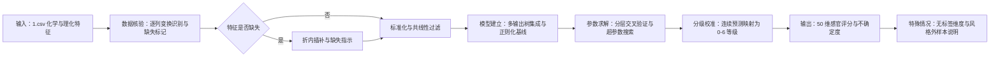
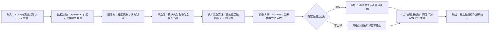

# 赛题识别与建模方案

> 文档性质：阶段 1 交付件，对应《妈妈提示词-前情提要》第一至第四部分  
> 版本：v0.1　日期：2026-10-28（Asia/Shanghai）  
> 前置依据：`成果/00_材料清点/00_数据字典与材料清点表.md`（下称“数据字典”）  
> 边界：本文只给出赛题识别、方案设计与求解框架，不含任何模型运行结果；所有结果类结论须待 `成果/code/` 中脚本实际运行后写入论文正文。

---

# 第一部分 赛题识别与题型归类

## 1.1 赛题的总体结构

赛道 A 的研究对象是市售啤酒的化学组成与感官品质之间的关系，数据由四个层面构成：化学/理化测量（250 个样品 × 231 列）、感官评分（250 个样品 × 50 维，中心化连续值）、三张相关矩阵（化合物间、感官间、化学–感官交叉）以及品评卡、阈值表、校准浓度等参考材料。三个问题并非并列的三道独立题，而是一条从“预测”到“解释”再到“设计”的递进链：

- 问题一建立“化学指纹 → 感官评分”的监督映射，回答“给定化合物谱，感官表现如何”；
- 问题二在这一映射的基础上回答“哪些化合物在起作用、证据是否稳定、是否符合化学常识”，其结论反过来支撑问题一的可解释性；
- 问题三把方向倒过来，要求“按风格生成合理的化合物谱”，并保证缺陷化合物不恶化，是对前两问知识的综合运用。

由此，全题的核心矛盾可以概括为五点：样本量小（250 个样品、22 个风格，最少的 Faro 仅 3 个样品）、输入维度高（231 列且逐列变换方式不同）、输出维度高且有序（50 维 0–6 分级，实际文件为标准化连续值）、存在真实缺失与检出限替代、生成任务缺乏唯一正确答案。后续模型选择必须同时回应这五点，任何只追求拟合精度或只追求方法新颖性的方案都不满足赛题需求。

## 1.2 问题一：数据缺失条件下的感官评分

**题目任务概括**：以 `1.csv` 的化学/理化特征为输入，给出 `3.xlsx` 中定义的 Aroma 与 Flavour 两套感官维度（按数据字典的映射，实际对应 `4.csv` 的 50 个感官列）的 0–6 分制分级评分，并处理数据缺失。

**最匹配的题型类别**：预测类。

**核心判定依据**：

1. 存在明确的输入（化学特征）与输出（感官评分），且 250 个样品同时具备两者，属于标准的监督学习设定；
2. 输出是离散有序等级（0–6），而非类别标签或连续物理量，评价重点是预测误差与等级一致性，符合“分类、回归、状态识别”为核心的预测类定义；
3. 题目不涉及约束极值、方案排序或物理机理方程，排除优化类、评价类与机理分析类；
4. 缺失值处理与分级校准是本题的主要风险来源，属于数理统计层面的辅助工作，不改变问题类型。

**可能涉及的理论知识与工具**：多输出回归、正则化线性模型（Ridge、ElasticNet、多任务 Lasso）、树集成（随机森林、极端随机树、梯度提升树）、有序回归与分级校准、多重插补与缺失指示变量、分层交叉验证、Bootstrap 置信区间、误差分解（偏差–方差、按风格/按维度的误差结构）。

**与后续问题的衔接**：问题一输出的 50 维感官预测器将在问题三中充当“感官画像代理”，用于评价生成化合物谱的感官合理性；问题一的特征重要性与残差结构为问题二提供候选化合物与可疑维度；问题一的 0–6 分级口径同时定义了问题三的评价输出形式。

## 1.3 问题二：化合物–风味分析

**题目任务概括**：以 `2.csv` 的化合物相关矩阵构建共表达图，结合 `1.csv` 特征，为每个感官维度给出 Top-3 关键因素化合物，并从稳定性（Bootstrap 入选频率、跨方法 Jaccard 系数）与化学合理性两方面进行论证。

**最匹配的题型类别**：评价类（排序与优选）。

**核心判定依据**：

1. 输出对象是“每个感官维度的前 3 名化合物”，本质是多指标下的排序与优选结果，而不是对样品或化合物的数值预测；
2. 题目明确要求量化稳定性和可解释性，评价类问题的方法论（指标构造、权重/排序、稳健性）与需求直接对应；
3. 数据以相关矩阵形式给出，相关性分析与重采样只是达成排序的手段，属于辅助的数理统计工具，不足以把整问归为数理统计类；
4. 该问不要求生成新样本或拟合机理方程，排除生成建模与机理分析。

**可能涉及的理论知识与工具**：相关网络与图论指标（度、中心性、社区发现）、偏相关与条件独立性、监督特征重要性（置换重要性、正则化系数、树模型分裂增益）、多方法集成排序、Bootstrap 重采样、Jaccard 系数、多重检验校正；化学侧证据包括气味阈值表、化合物来源（酵母/酒花/麦芽/野生菌群）与已知代谢通路。

**与后续问题的衔接**：问题二的 Top-3 清单为问题一提供局部可解释性证据，也为问题三提供“必须约束的关键化合物”候选；问题一的重要性排序可作为问题二多方法投票中的一员，形成“预测—解释”的闭环校验。

## 1.4 问题三：风味与“风味指纹”生成

**题目任务概括**：以 `tasting_category_fine` 为风格标签，学习风格条件生成模型，在给定风格（如 Tripel、Kriek、Lambic）下生成合理的化合物谱并给出感官画像；同时完成跨风格迁移（如把 Pils/Lager 的化合物谱迁移为 Tripel 风格），并保证缺陷化合物不恶化。

**题型归类**：本题**无法归入**题目限定的五类题型，其原因如下：

1. 目标不是对单个标签的预测（预测类）——同一风格下存在多条合理化合物谱，输出是分布而非点估计；
2. 目标不是排序或评分（评价类）——没有“候选方案优劣比较”的任务结构；
3. 目标不是参数估计或假设检验（数理统计类）——虽然训练中大量使用统计工具，但核心任务是学习条件分布并采样；
4. 目标不是由物理规律或守恒关系驱动的机理方程（机理分析类）——发酵与风味形成虽有生化背景，但题目要求的是数据驱动的生成模型；
5. 更准确的问题结构判断是：**条件生成建模（生成式机器学习）＋ 受约束的跨风格迁移（多目标约束优化）**。前者负责学习“风格 → 化合物谱”的条件分布，后者负责在潜空间或样本空间中寻找满足“目标风格像、缺陷不恶化”的迁移方向。

**可能涉及的理论知识与工具**：条件变分自编码器、条件生成对抗网络、条件扩散模型（小样本下需谨慎）、潜空间方向向量与最优传输、阈值投影与可行性修复、代理模型（以问题一的感官预测器作为评分函数）、分布距离（MMD 等）、风格分类器准确率、相关性结构保持度。

**与后续问题的衔接**：问题三的生成结果必须用问题一的预测器评估感官画像，并用问题二的 Top-3 与阈值表解释生成谱的合理性；三个问题由此形成完整闭环。

## 1.5 各问题归类汇总

| 问题编号 | 题型归类 | 核心判定依据 | 建议主模型方向 |
| --- | --- | --- | --- |
| 问题一 | 预测类（辅助：数理统计） | 有监督的“化学特征 → 有序感官评分”映射；输出 50 维有序等级；核心风险是缺失与分级口径 | 多输出树集成 + 正则化线性基线 + 分级校准；折内插补与缺失指示 |
| 问题二 | 评价类（辅助：数理统计） | 输出为每维度 Top-3 排序；要求稳定性与化学合理性；相关矩阵只是结构先验 | 共表达图结构先验 + 多方法重要性集成 + Bootstrap/Jaccard 稳定性 |
| 问题三 | 五类之外：条件生成建模 + 受约束迁移 | 需学习风格条件分布并生成新样本；无唯一正确答案；含缺陷阈值与跨风格约束 | 条件变分自编码器为主，潜空间迁移/最优传输完成风格转换，阈值投影与问题一代理模型闭环约束 |

---

# 第二部分 解题方向设计

## 2.1 问题一：从化学指纹到感官评分

### 方案 A：正则化线性多输出回归（基线）

- 适用前提：化学特征与感官评分近似线性相关；需要强可解释性与稳定的外推行为。
- 核心思路：对 50 个感官维度分别建立 Ridge/ElasticNet 回归，或以多任务 Lasso 共享稀疏结构；配合折内标准化与插补。
- 优点：参数少、方差低、系数可直接解释；在 250 个样本的规模下不易过拟合；可作为其他模型的性能下界。
- 风险与局限：难以刻画阈值型、交互型与饱和型非线性关系（香气化合物普遍存在阈值效应），拟合优度可能偏低。
- 与赛题需求的匹配程度：中。适合做基线与可解释性对照，不适合单独作为最终方案。

### 方案 B：多输出树集成 + 逐维校正（推荐主方案）

- 适用前提：特征与目标之间存在非线性与交互；可接受中等规模超参数搜索；需要同时处理 50 个相关输出。
- 核心思路：以随机森林/极端随机树/直方图梯度提升树建立多输出回归；对每个感官维度单独训练与共享模型两种结构做对照；以分层 K 折交叉验证选择超参数，并利用输出相关性做误差协同分析。
- 优点：对非线性、异常值与混合尺度特征稳健；可输出置换重要性，与问题二直接衔接；在中小样本高维数据上通常优于线性模型。
- 风险与局限：对超参数与随机种子敏感；50 个输出逐一建模时计算量较大；对极端小样本风格的外推能力有限。
- 与赛题需求的匹配程度：高。兼顾精度、可解释性与工程可行性。

### 方案 C：潜因子降维后回归

- 适用前提：50 个感官维度高度相关，可由少数潜因子近似；需要降低输出维度带来的方差。
- 核心思路：先对 `4.csv` 的感官矩阵做因子分析/主成分分析提取 5–10 个潜因子，再建立“化学特征 → 潜因子”的回归，最后投影回 50 维；或对化学侧做 PLS，直接建立双向潜变量关系。
- 优点：显著降低输出维度、缓解共线性、便于解释“风味主成分”；在样本量有限时方差更可控。
- 风险与局限：潜因子投影会损失维度特异性，难以保证 50 维逐维精度；潜因子的可解释命名依赖主观判断。
- 与赛题需求的匹配程度：中高。适合作主方案的对照与降维合理性论证。

### 方案 D：有序回归/分级分类 + 分级校准

- 适用前提：题目要求的最终输出是 0–6 离散等级，且等级间存在顺序关系。
- 核心思路：将回归输出通过有序阈值（累积链接模型或分位数映射）转换为 0–6 等级；比较“回归后取整”“有序分类”“分级校准”三种方式对等级准确率的影响。
- 优点：直接优化题目要求的输出形式；可报告 ±1 等级容差内的准确率，避免回归指标与分级目标脱节。
- 风险与局限：0–6 原始整数在 `4.csv` 中不存在，阈值映射只能基于标准化分布假设，存在系统性偏差风险。
- 与赛题需求的匹配程度：高（作为方案 B 的校准层，而非独立主模型）。

**推荐主方案及理由**：以**方案 B（多输出树集成）为主模型**，**方案 A 作基线对照**，**方案 D 作分级校准层**，**方案 C 作稳健性对照**。理由有三：其一，250 个样本、231 维特征、50 维输出的数据规模下，树集成的非线性能力与正则化能力匹配度最高；其二，题目要求“数据缺失条件下”的评分，树模型对插补方式的敏感性低于线性模型，便于做缺失处理敏感性分析；其三，树模型的置换重要性可以直接与问题二的 Top-3 对齐，形成前后问的连贯证据链。

**与其他问题的衔接**：问题一的最优模型将固化为可调用的预测器，作为问题三的感官代理；其重要性排序与残差分析结果进入问题二的候选池与稳定性检验；分级校准规则同时用于问题三生成谱的感官画像输出。

## 2.2 问题二：关键化合物识别与稳定性论证

### 方案 A：纯图结构排序

- 适用前提：共表达图已经包含足够的“关键化合物”信息；感官维度与图社区存在对应关系。
- 核心思路：在 `2.csv` 上计算度、介数、特征向量中心性等指标，结合社区发现划分模块，按“与目标感官维度所在模块的连接强度”排序取 Top-3。
- 优点：完全基于题目给出的矩阵，方法透明、可复现；能揭示化合物协同/共表达结构。
- 风险与局限：相关性不等于因果，中心性高不代表与特定感官维度相关；无法区分“共同上游因素”造成的伪相关。
- 与赛题需求的匹配程度：中。适合作为结构先验，不足以单独支撑“关键因素”结论。

### 方案 B：多方法监督重要性集成 + Bootstrap 稳定性（推荐主方案）

- 适用前提：有 250 个样品、231 个化合物的完整观测（含缺失）与 50 个感官目标。
- 核心思路：对每个感官维度并行使用至少四类证据——树模型置换重要性、偏相关（控制风格与其他化合物）、ElasticNet 稀疏系数、共表达图模块贡献；以排名聚合（Borda 或平均排名）得到综合排序，取 Top-3；用 1,000 次 Bootstrap 重采样统计入选频率，用不同方法间的 Jaccard 系数衡量一致性。
- 优点：同时给出“重要性”与“稳定性”两类证据，直接对应题目要求；多方法投票降低单一模型偏差；偏相关可部分缓解混杂。
- 风险与局限：计算量较大；对缺失处理方式敏感；排名聚合权重带有主观性，需要报告敏感性。
- 与赛题需求的匹配程度：高。与题目“稳定性 + 化学合理性”双重要求最贴合。

### 方案 C：图嵌入 + 监督模型

- 适用前提：共表达图能通过节点嵌入刻画化合物相似性，且嵌入可提升监督预测。
- 核心思路：用 node2vec/图自编码器得到化合物嵌入，再以嵌入为特征训练“感官维度预测”模型，按梯度/注意力解释重要性。
- 优点：可捕捉高阶图结构；理论上比一阶相关更全面。
- 风险与局限：250 个样本上图神经网络的参数量与样本量严重不匹配，容易过拟合；解释性弱于直接重要性；实现与调参成本高。
- 与赛题需求的匹配程度：低中。建议只在讨论部分作为扩展方向，不作为主方案。

### 方案 D：官方交叉相关矩阵直接排序

- 适用前提：`6.csv` 的 44×50 交叉相关足以代表化学–感官关系。
- 核心思路：对每个感官维度，按 `6.csv` 中相关系数绝对值排序取 Top-3。
- 优点：最简单、可复现，直接使用官方给出的证据。
- 风险与局限：仅覆盖 44 个化合物（实际 231 个），遗漏大量候选；相关未控制混杂，容易选出“伪关键”化合物。
- 与赛题需求的匹配程度：低。只能作为外部对照与合理性证据。

**推荐主方案及理由**：以**方案 B 为主**，**方案 A 提供图结构先验**，**方案 D 作外部对照**，方案 C 仅作讨论。理由：题目把“稳定性”写进了评分要求（Bootstrap 入选频率、跨方法 Jaccard），只有方案 B 能在方法层面同时给出这两类量化证据；方案 A 的社区结构可以帮助约束候选池、降低多重比较风险；方案 D 的官方矩阵可作为第三方验证，但因其覆盖率仅 44/231，不能作为主依据。

**稳定性判定约定**：Bootstrap 入选频率 ≥80% 记为“稳定”，50%–80% 记为“边缘”，<50% 记为“不稳定”；跨方法 Jaccard ≥0.5 记为“方法一致”，0.3–0.5 为“部分一致”，<0.3 为“不一致”。该约定为方法学假设，论文中需明确写出并做阈值敏感性分析。

**与其他问题的衔接**：问题二的 Top-3 与问题一的置换重要性做一致性比对（可计算排名相关系数）；问题三的缺陷约束清单以问题二识别出的关键化合物与阈值表为准。

## 2.3 问题三：风格条件生成与跨风格迁移

### 方案 A：条件变分自编码器（cVAE，推荐主方案）

- 适用前提：250 个样品、22 个风格；可用风格标签作为条件；需要可控采样与潜空间插值。
- 核心思路：将化合物谱统一到一致空间（含物理浓度的列取 log10，未校准列保持原值并标准化），以风格标签为条件训练 cVAE；编码器学习“化合物谱 → 潜变量”，解码器学习“潜变量 + 风格 → 化合物谱”；生成时按目标风格采样并解码。
- 优点：训练稳定、小样本友好；潜空间可解释、支持插值与方向迁移；生成谱连续且可微，便于叠加约束。
- 风险与局限：易出现“生成谱过于平滑、相关性结构弱化”的问题；重构项与分布项权重敏感；小样本风格的条件分布估计不稳定。
- 与赛题需求的匹配程度：高。小样本条件下比 GAN/扩散模型更可控。

### 方案 B：条件生成对抗网络（cGAN / CTGAN 变体）

- 适用前提：需要更高保真的样本级生成；有足够的训练稳定性技巧（谱归一化、小批量判别等）。
- 核心思路：生成器以“噪声 + 风格”为输入，判别器区分真实/生成谱并判别风格一致性；引入模式覆盖项缓解模式坍塌。
- 优点：样本保真度潜力更高；可直接优化判别目标。
- 风险与局限：250 个样本训练 GAN 极易模式坍塌与过拟合；调参成本高、结果随机性大。
- 与赛题需求的匹配程度：中。适合作对照实验，不建议作为唯一主方案。

### 方案 C：条件扩散模型

- 适用前提：样本量充足（通常 ≥10³）、训练算力可接受。
- 核心思路：在化合物谱空间上学习条件去噪过程，按风格条件反向扩散生成。
- 优点：生成质量与多样性通常优于 VAE/GAN。
- 风险与局限：250 个样本远小于扩散模型的常规需求，过拟合与训练不稳定风险高；推理成本大。
- 与赛题需求的匹配程度：低。建议列入“方法扩展与局限”讨论。

### 方案 D：潜空间迁移与最优传输（与方案 A 组合）

- 适用前提：已有一个可用的条件生成器或潜空间编码器；源风格与目标风格存在对应样品。
- 核心思路：在潜空间中估计“源风格 → 目标风格”的方向向量（用两类风格样本的均值差或最优传输映射），对源风格化合物谱做平移；迁移后用阈值投影修复缺陷化合物，再用问题一预测器评估感官画像。
- 优点：迁移方向清晰、可解释；计算量小；便于做“缺陷不恶化”的约束修复。
- 风险与局限：均值差方向可能破坏样本级相关性结构；跨风格迁移若风格差异过大（如 Lambic→Tripel），线性方向未必成立。
- 与赛题需求的匹配程度：高（作为方案 A 的迁移模块）。

**推荐主方案及理由**：以**方案 A（cVAE）为核心生成模型**，**方案 D 完成跨风格迁移**，**方案 B 作对照实验**，方案 C 在局限部分讨论。理由：样本规模（250）不支持扩散模型与大规模 GAN 的稳定训练；cVAE 的潜空间天然支持“插值与方向迁移”，与题目要求的“跨风格迁移”在方法上同构；缺陷约束通过“生成后阈值投影 + 问题一代理评分”的闭环实现，既不破坏生成模型的训练目标，又能满足硬约束。

**缺陷约束与评价体系**：

1. 缺陷集合：DMS、双乙酰、4VG 三项有官方阈值（17.25 µg/L、0.29925 mg/L、0.206333 mg/L）；反-2-壬烯醛阈值缺失，采用“相对自身基线不恶化”的分位约束；陈旧酒花无化学阈值，改用 `4.csv` 的感官列作为约束。
2. 约束方式：生成样本后对超阈值维度做阈值投影或拒绝重采样；“不恶化”按逐样品相对源样品基线判定。
3. 评价指标：生成谱与真实谱的分布距离（MMD）、风格分类器准确率、缺陷超阈值比例的迁移前后对比、化合物相关结构保持度、问题一代理模型的感官画像误差、化学合理性抽查。
4. 由于生成任务无唯一答案，论文将以“指标 + 消融 + 对照”呈现，不做“最优模型”的绝对化表述。

**与其他问题的衔接**：问题三的感官画像由问题一预测器给出；缺陷约束清单与关键化合物解释来自问题二；问题三的生成结果反过来可检验问题一模型在分布外样本上的稳定性。

---

# 第三部分 整体求解思路

## 3.1 总体框架

全题采用“统一数据契约 + 分问建模 + 闭环验证”的技术路线。统一数据契约指所有问共享同一份经过核验的数据视图：231 维化学特征按原值进入模型，缺失值在训练折内插补并附加缺失指示，50 维感官目标保持标准化连续值并在输出层统一映射为 0–6 分级；凡涉及物理浓度与阈值的计算，统一使用 `8.xlsx` 校准浓度表或按已验证的逐列变换规则还原。分问建模指问题一以监督回归刻画化学–感官映射，问题二以多方法重要性排序解释该映射，问题三以条件生成与潜空间迁移完成反向设计。闭环验证指问题一为问题三提供感官代理，问题二为问题一与问题三提供解释与约束锚点，三问的验证结果相互引用、相互约束，避免各自为政。

## 3.2 问题一的求解框架

问题一的目标是在化学特征与感官评分之间建立可泛化、可解释的映射。关键影响因素有三类：化学特征的尺度差异与共线性、感官维度之间的强相关结构、以及样本量有限带来的方差压力。建模切入点选择“多输出树集成 + 正则化线性基线 + 分级校准”的组合：树集成负责捕捉阈值效应与交互作用，正则化线性模型提供稳定的基线并暴露线性可解释结构，分级校准层负责把连续预测转化为题目要求的 0–6 等级。该组合之所以适合本题，在于它同时回应了小样本、高维输入、多输出与有序目标四个约束，且其置换重要性可直接支撑问题二。与前后问题的联系体现在：问题一的预测器是问题三评价生成谱感官合理性的唯一量化工具，其误差结构又为问题二提示哪些感官维度更值得深入解释。

## 3.3 问题二的求解框架

问题二的目标是在化合物共表达结构与感官维度之间建立可检验的对应关系，并给出稳定的 Top-3 关键化合物。关键影响因素包括：相关矩阵的统计口径（已核验为 Spearman）、缺失值处理方式对相关系数的影响、化合物之间的共表达模块结构、以及风格混杂导致的伪相关。建模切入点是以 `2.csv` 的图结构提供候选池与模块约束，以多种监督重要性方法给出每个感官维度的排序，再以 Bootstrap 与跨方法 Jaccard 系数刻画稳定性。该设计适合本题的原因在于：题目明确要求“稳定性 + 化学合理性”两类证据，而单一方法无法同时提供；图结构提供先验、监督方法提供目标导向、重采样提供不确定度，三者互补。与前后问题的联系体现在：问题二的关键化合物清单既是问题一模型解释的落脚点，也是问题三缺陷约束与生成谱解释的化学依据。

## 3.4 问题三的求解框架

问题三的目标是在给定风格条件下生成合理的化合物谱，并完成满足缺陷约束的跨风格迁移。关键影响因素包括：风格标签的样本不均衡、化合物谱的逐列变换差异、缺陷阈值的单位与完整性、以及生成模型在小样本下的稳定性。建模切入点是以条件变分自编码器学习“风格 → 化合物谱”的条件分布，以潜空间方向向量或最优传输完成风格迁移，以阈值投影与问题一代理模型构成约束闭环。该方案适合本题的原因在于：cVAE 在小样本条件下的训练稳定性优于 GAN 与扩散模型，潜空间结构天然支持可控迁移；阈值投影把“缺陷不恶化”从软惩罚变成硬约束，避免了生成模型为了拟合分布而牺牲化学合理性。与前后问题的联系体现在：问题三的感官画像由问题一输出，缺陷与关键化合物的解释由问题二提供，三问由此构成“预测—解释—设计”的完整闭环。

---

# 第四部分 模型应用逻辑图

## 4.1 问题一模型应用逻辑

## 4.2 问题二模型应用逻辑

## 4.3 问题三模型应用逻辑

---

## 附：本文引用的核验证据索引

| 事实 | 证据文件 |
| --- | --- |
| 文件清单与 SHA256 | `成果/results/00_材料清单.json` |
| 逐列变换核验（37 log10 / 33 原值 / 16 推断） | `成果/results/00_数值变换核验.csv` |
| 相关矩阵复现比对 | `成果/results/00_相关矩阵复现对比.json` |
| 3.xlsx 维度到 4.csv 的映射 | `成果/results/00_感官维度映射.csv` |
| 变量名映射（2/5/6.csv → 1/4.csv） | `成果/results/00_数据字典_字段映射.csv` |
| 全部汇总数字 | `成果/results/00_审计摘要.json` |
