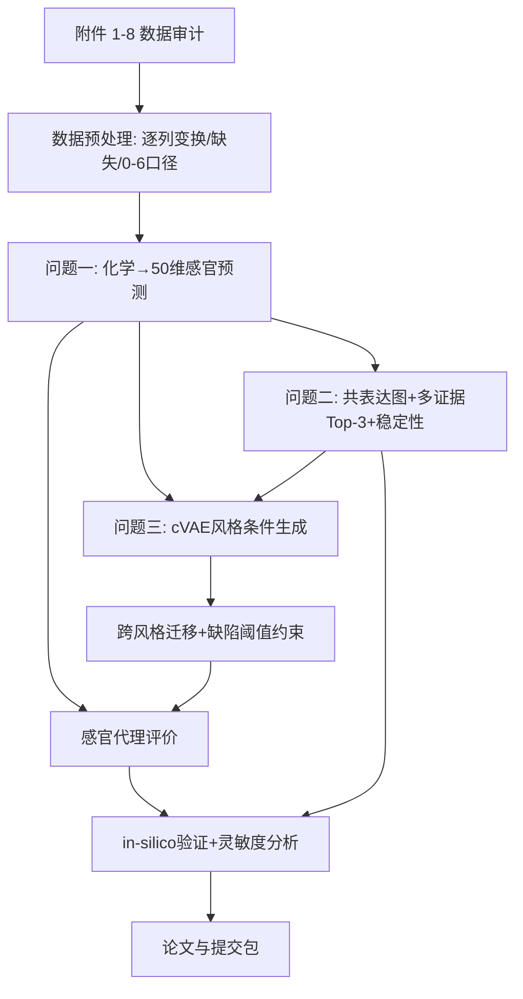

# 一、问题重述

## 1.1 问题背景

啤酒是世界上消费量最大的酒精饮料之一，其风味由麦芽、酒花、酵母与发酵工艺共同决定。现代酿造工业可以在实验室中精确测量数百种化学与理化指标（醇类、酯类、萜类、酸类、糖类、蛋白质、色度、苦度等），但“化学组成如何转化为人的感官体验”仍是食品科学中的核心难题：一方面，香气化合物普遍存在阈值效应与协同/掩蔽作用；另一方面，感官评价依赖品评员、存在个体差异与噪声。参考论文 Schreurs 等（Nature Communications, 2024）用 10 种机器学习模型对 250 款商业啤酒的化学谱与感官评分/消费者喜好进行了系统研究，发现梯度提升类模型在消费者喜好预测上表现最好，并指出共线性导致的重要性偏差、模型难以学习过高浓度惩罚等局限。

本题以该研究的数据为基础，给出三个层层递进的任务：先用化学特征预测感官评分，再解释“哪些化合物在起作用”，最后按风格生成合理的化合物谱并做跨风格迁移。三个任务对应“预测—解释—设计”的完整链条，要求在数据缺失、小样本、高维、多输出的条件下给出可复现、可解释、可验证的方案。

## 1.2 问题提出

**问题一**：以 `1.csv` 的化学/理化测量为输入，给出 `3.xlsx` 中定义的 Aroma 与 Flavour 两套感官维度在 0–6 分制下的分级评分，并处理数据缺失。

**问题二**：以 `2.csv` 的化合物相关矩阵构建共表达图，结合 `1.csv` 的特征，为每个感官维度给出 Top-3 关键因素化合物，并从稳定性与化学合理性两方面进行论证。

**问题三**：以 `tasting_category_fine` 为风格条件，学习风格生成模型，生成合理的化合物谱与感官画像；完成跨风格迁移（例如 Pils/Lager → Tripel），并保证缺陷化合物（DMS、Diacetyl、4VG、trans-2-nonenal、Stale hops）不恶化。

## 1.3 附件数据说明

题目附件共 9 个文件：`1.csv`（250 样品 × 234 列，其中 231 列为化学/理化特征）、`2.csv`（231×231 化合物相关矩阵）、`3.xlsx`（品评卡，58 个评分项 + summary）、`4.csv`（250×53，50 个感官维度，逐品评员 z 分数后平均）、`5.csv`（50×50 感官相关矩阵）、`6.csv`（44×50 官方化学–感官交叉相关）、`7.csv`（250×189，186 个消费者描述符）、`8.xlsx`（校准浓度、阈值表、GBM 重要性、SHAP 值等参考表）、`数据说明.txt`。数据的具体字段、变换与核验结论见“数据预处理”章与数据字典。

# 二、问题分析

## 2.1 总体判断：三个问题构成“预测—解释—设计”的递进链

三个问题不是彼此独立的三道题：问题一建立“化学指纹 → 感官评分”的监督映射，回答“给定化合物谱，感官表现如何”；问题二在该映射基础上回答“哪些化合物在起作用、证据是否稳定、是否符合化学常识”，其结论反过来支撑问题一的可解释性；问题三把方向倒过来，要求“按风格生成合理的化合物谱”，并保证缺陷不恶化，是对前两问知识的综合运用。全题的核心矛盾可概括为五点：**样本量小**（250 个样品、22 个风格，最少的 Faro 仅 3 个样本）、**输入维度高且逐列变换不同**（231 列，37 列 log10、33 列原始浓度经证实，145 列推断为 log10）、**输出维度高且有序**（50 维、0–6 分级，而实际文件为标准化连续值）、**存在真实缺失**（73 格，集中在 9 列）、**生成任务没有唯一正确答案**。任何只追求拟合精度或方法新颖性的方案都不满足赛题需求。

## 2.2 问题一的分析

**题型判断：预测类（辅助：数理统计）。** 依据是：存在明确的输入（化学特征）与输出（感官评分），250 个样品同时具备两者；输出为有序等级；题目不涉及优化、排序或机理方程。

**关键难点**：① 231 维输入、250 个样本，方差压力大；② 输出 50 维且彼此相关，需要比较多输出与逐维建模；③ `4.csv` 是逐品评员 z 分数平均，0–6 原始整数不可恢复，分级只能作为明示假设；④ 73 个缺失格与逐列不同的变换方式会影响结果；⑤ 香气维度的阈值效应使线性模型难以拟合。

**求解思路**：按“论文基线复现 → 改进评估 → 解释与衔接”三层展开。基线用参考论文的 10 模型口径（LR、Lasso、PLSR、AdaBoost、ET、GBR、RF、XGBoost（本机以 HistGBDT 替代）、SVR、ANN（MLP 替代））建立 70/30 分层划分下的对照；改进评估用重复分层交叉验证（5 折×3 次）比较 Extra Trees、Random Forest、HistGBDT 与线性基线，并做缺失处理敏感性、0–6 分级校准、逐风格/逐目标误差分解与不确定性分析；解释层用置换重要性与 PDP，并与 8.xlsx 的论文 MDI 做外部对照。最终模型固化为问题三的感官代理。

## 2.3 问题二的分析

**题型判断：评价类（排序与优选；辅助：数理统计）。** 依据是：输出对象是“每个感官维度的前 3 名化合物”，本质是多指标下的排序与优选，而非对样品或化合物的数值预测；题目明确要求量化稳定性与化学合理性；相关矩阵只是结构先验。

**关键难点**：① 231 个化合物高度共线，单个变量的重要性会被“共表达替身”分走（参考论文明确指出 GBR 的 MDI/SHAP 会偏向主效应最大的变量）；② 250 个样本下 Top-3 精确组成本身可能不稳定，需要量化而不能掩盖；③ “关键因素”必须经得起化学解释（来源、阈值、与官方交叉相关一致性）。

**求解思路**：用 2.csv 构建共表达图（|r|≥0.5）并做社区发现，得到化合物模块作为“多样性单位”；对每个感官维度综合四类证据——风格控制偏相关、Ridge 系数、随机森林基尼重要性、官方 6.csv 交叉相关；以各证据百分位平均排序，施加“同一模块最多 1 个”的多样性约束后取 Top-3；用 25 次重复分层重采样统计入选频率与跨方法 Jaccard；用阈值表、来源类别与官方符号一致性做化学合理性核验。

## 2.4 问题三的分析

**题型判断：无法归入题目限定的五类题型**，更准确的结构是**条件生成建模（生成式机器学习）+ 受约束的跨风格迁移（多目标约束优化）**。依据是：同一风格下存在多条合理化合物谱，输出是分布而非点估计；没有候选方案优劣比较的排序结构；核心是学习条件分布并采样；发酵与风味虽有生化背景，但题目要求的是数据驱动模型而非机理方程。

**关键难点**：① 250 个样品、22 个风格，小风格仅 3–4 个样品，生成模型易过拟合或后验坍缩；② 各列量纲/变换不一致，直接生成原始值会混淆“对数空间”与“浓度空间”；③ 缺陷化合物有明确阈值，但模型在过高浓度区趋于平台、学不到惩罚，仅靠数据驱动不足以满足“缺陷不恶化”；④ 没有真实品评实验，只能做 in-silico 验证。

**求解思路**：按数据字典的逐列变换规则把 231 列统一到对数浓度空间并标准化；以风格 one-hot 为条件训练小容量 cVAE；生成时从“风格后验均值 + 小噪声”采样；迁移用“条件解码 + 潜空间风格方向平移”两条路径并按风格分类器置信度选择；对缺陷化合物做阈值投影、对 t2n 做“不劣于源样品”约束、对 stale hops 做代理感官软约束；最后用问题一代理、风格分类器、MMD、7.csv 消费者描述符做 in-silico 评价。

## 2.5 三个问题的衔接与总体求解框架

总体求解框架可概括为“一条主线、两个闭环”：主线是“数据预处理 → 问题一预测 → 问题二解释 → 问题三生成”；两个闭环分别是“问题一模型作为问题三评价代理”的**评价闭环**，以及“问题二 Top-3/阈值作为问题三约束”的**约束闭环**。该框架既满足题目对三问的独立要求，又使三问的结论互相支撑。
