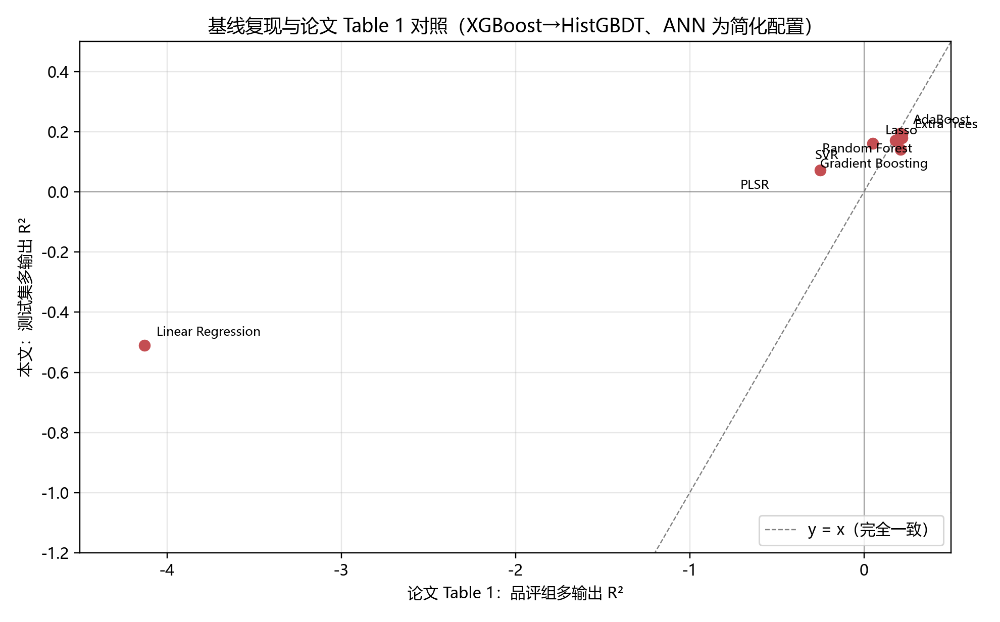
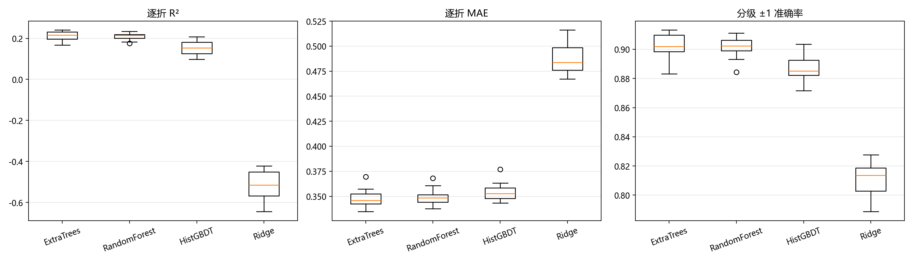
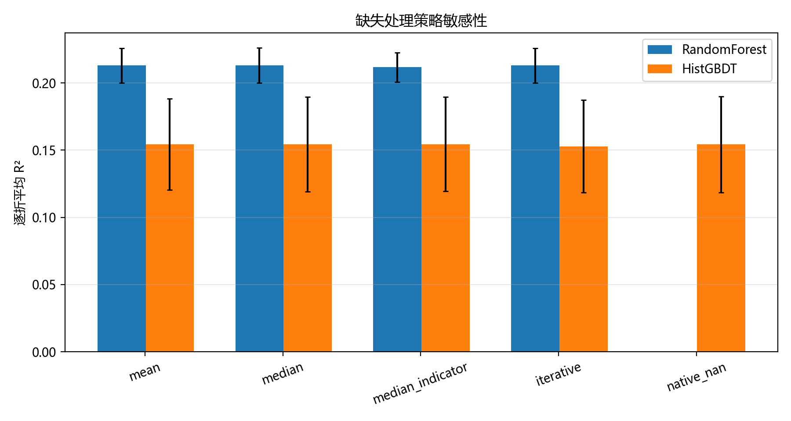
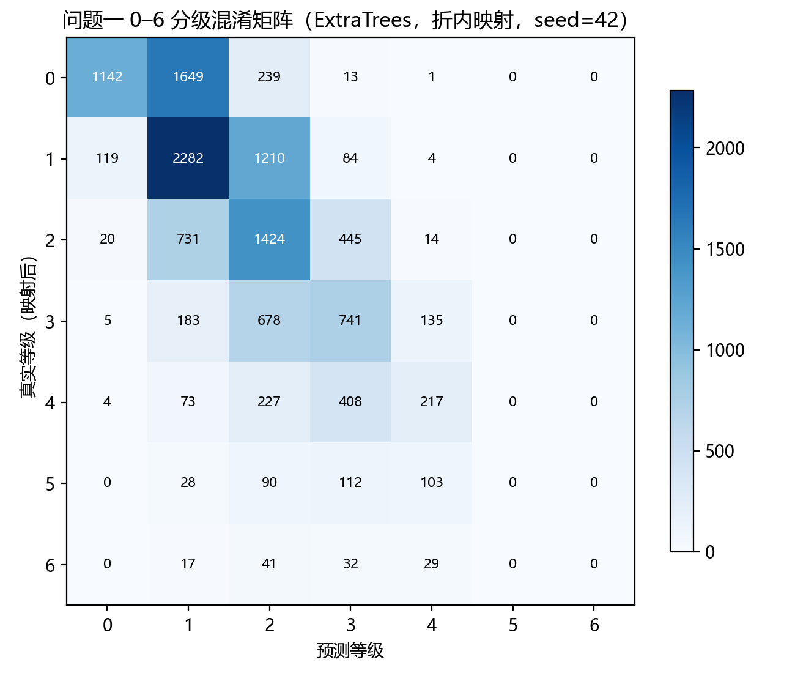
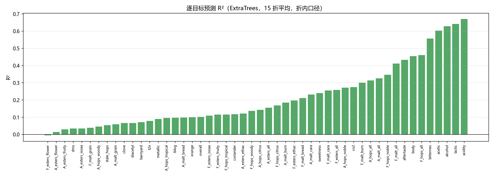
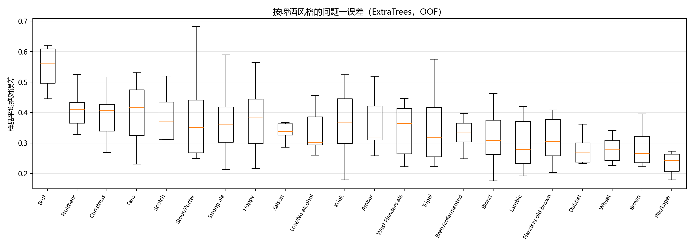
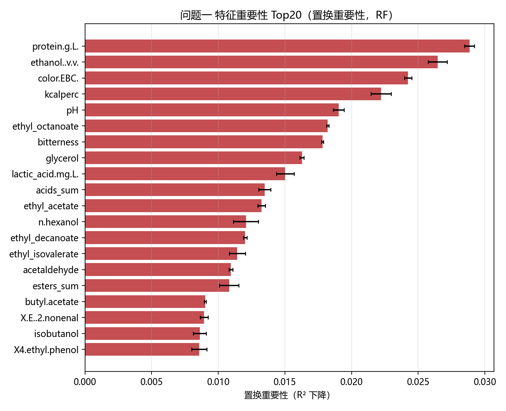
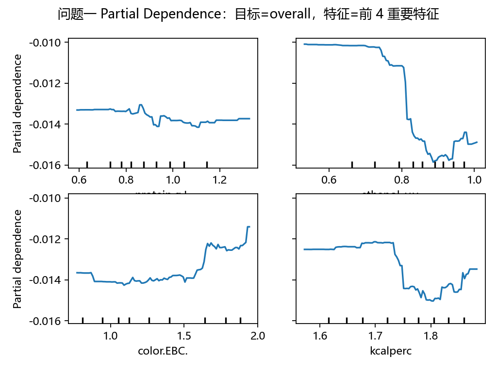
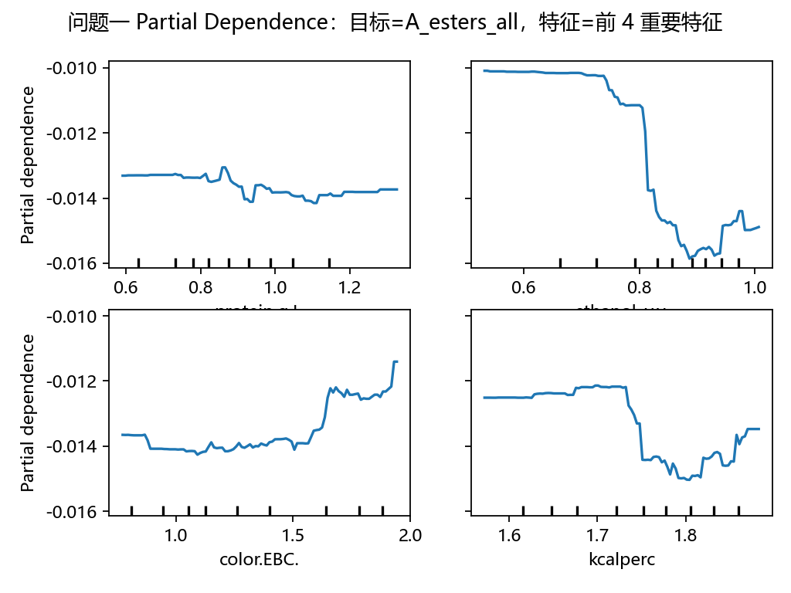
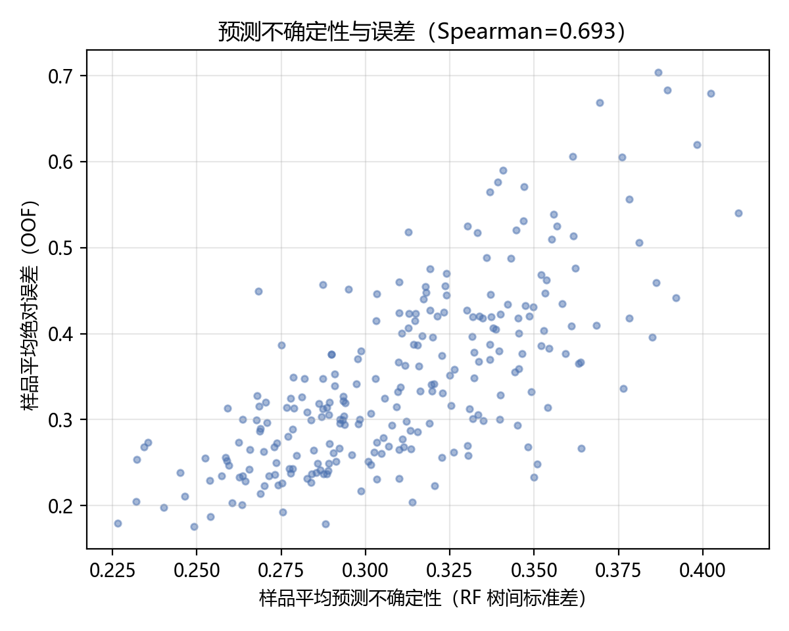

# 问题一：数据缺失条件下的感官评分

> 所属：论文正文“模型建立与求解”之问题一（按 `资料/Mathorcup论文标准模板(1).docx` 的“求解思路 → 模型建立 → 模型求解与分析”小节组织；同时对应《妈妈提示词》第五部分“模型建立与论文正文”与第六部分“代码生成”的要求）。
> 数字来源：`成果/results/03_q1_基线结果.*`、`03_q1_改进_*`；脚本：`成果/code/03_q1_baseline.py`、`03_q1_improved.py`、`03b_q1_postprocess.py`、`03c_q1_consistency.py`；图：`成果/figures/fig_q1_*.png`。所有结果可由脚本重跑得到，随机种子 42。

---

## 1 问题一求解思路

问题一要求以 `1.csv` 的化学/理化测量为输入，给出 `3.xlsx` 所定义的 Aroma 与 Flavour 两套感官维度、0–6 分制的分级评分。经数据审计（见数据字典），本题的实际输入为 250 个样品 × 231 个化学/理化特征，目标为 `4.csv` 的 50 个感官维度（逐品评员 z 分数后的平均值），其中 56 个品评卡评分项可映射到 50 个目标列，2 个“乙醛”评分项无对应标签；`1.csv` 存在 73 个缺失格，且数值变换逐列不同（37 列 log10、33 列原始浓度可逐元素证实，145 列因负值推断为 log10，16 列非负待核验）。

因此，问题一的本质是一个**小样本、高维输入、多输出、有序目标**的监督学习问题，主要难点有四：其一，250 个样品对应 231 个特征，方差压力大；其二，50 个感官维度彼此相关，逐维建模与多输出建模需要比较；其三，目标值是逐品评员标准化后的连续 z 分数，而题目要求 0–6 分级，原始整数分不可直接恢复，分级口径只能作为明示假设；其四，缺失值处理方式可能影响结论，需要做敏感性分析。

据此，求解路线分为三层：

1. **论文基线复现**：按参考论文的 10 模型口径（Linear Regression、Lasso、PLSR、AdaBoost、Extra Trees、GBR、Random Forest、XGBoost、SVR、ANN）在 70/30 风格分层划分上建立基线，判断我们的实现是否落在论文量级（决策 1A/2A）；
2. **改进评估**：以重复分层交叉验证替代单次划分，比较 Extra Trees、Random Forest、HistGBDT 与线性基线，加入缺失处理敏感性、0–6 分级层、逐风格/逐目标误差分解与预测不确定性（决策 6A）；
3. **解释与衔接**：用置换重要性、PDP 分析化学特征的作用，并与 8.xlsx 提供的论文 GBM 重要性做外部对照（决策 3A）；问题一的预测器将作为问题三“感官画像代理”，其特征重要性可为问题二提供候选（决策 4B 的辅助目标体系另见问题三）。

## 2 数据预处理与目标口径

### 2.1 输入特征与缺失

- 输入：`1.csv` 的 231 个化学/理化列。数据审计表明其数值变换逐列不同：70 个可与 `8.xlsx` 校准浓度逐元素对照的列中，37 列为 log10 变换、33 列为原始浓度；其余 145 列因存在负值判定为 log10，16 列非负且无对照（按原始量纲处理，见数据字典 4.1 节与本论文“数据预处理”章）。**问题一直接使用 `1.csv` 的给定数值**，不强行统一反变换，以避免对未校准列引入额外误差。
- 缺失：`1.csv` 共 73 个缺失格，集中在 9 列（`amyl.acetate` 27、`aroma_hops_sum` 13、`methylpyrazine` 12、`X2.3.butanedione` 9、`X3.methylbutanal` 7 等）。主口径为**折内中位数插补 + 缺失指示列**（插补器只在训练折上拟合，避免信息泄漏）；敏感性分析比较训练均值（论文做法）、中位数、中位数+指示、IterativeImputer 与 HistGBDT 原生 NaN 五种方式。
- 标准化：树模型不依赖特征尺度；线性基线在折内做标准化，并对标准化值裁剪到 ±5（少量特征在训练折内近似常量，验证样品会产生极端 z 值，导致线性外推爆炸；裁剪只影响 Ridge 基线，见结果 4.2）。

### 2.2 目标与 0–6 分级口径

- 目标：`4.csv` 的 50 个感官列。论文 Methods 表明其口径为“各品评员分数按该品评员标准差缩放并均值中心化后取平均”，故均为 z 分数，列标准差 0.37–0.86。
- **0–6 分级**：原始整数分未随附件提供，本文采用两种明示假设的单调映射：
  - **min–max（主口径）**：在训练折上取各维最小/最大值，线性映射到 [0,6] 后四舍五入；
  - **分位等频（备选口径）**：按训练折经验分位数切成 7 个等级。
  两种映射均只在训练折上拟合、在验证折上应用；其差异作为分级口径敏感性分析。必须强调：分级结果是**在该映射假设下的等级**，不等于原始品评整数分。
- 验证：按 `tasting_category_fine` 分层的重复交叉验证（5 折 × 3 次，种子 42/1024/2024），共 15 折；报告逐折指标的均值与标准差。

### 2.3 评价指标

- 回归指标：逐维决定系数 R²、平均绝对误差 MAE、Spearman 秩相关，先在维度上取宏平均，再在 15 折上取均值±标准差；
- 分级指标：与映射后真值比较的精确率、±1 等级准确率、二次加权 Kappa（7 个等级）；
- 稳定性与诊断：逐风格误差、逐目标 R²、单样品预测不确定性（RF 树间预测标准差与 OOF 误差的秩相关）。

## 3 模型建立

### 3.1 基线模型（论文口径）

按参考论文设置 10 个模型：3 个线性模型（Linear Regression、Lasso、PLSR）、5 个树模型（AdaBoost、Extra Trees、GBR、Random Forest、XGBoost）、1 个核方法（SVR）与 1 个神经网络（ANN/MLP）。输入为训练集均值填补并按训练集均值/标准差标准化；评价为 70/30 风格分层划分下的测试集多输出 R²，以及逐维 R² 的平均排名（1 = 最好）。

本机无 `xgboost` 与 `shap`、且不联网安装，故做三处**显式替代**并在论文中声明：① XGBoost → HistGradientBoosting；② ANN 采用 scikit-learn MLP（固定小网络 + 早停，未做论文的 Optuna 贝叶斯调参）；③ Linear Regression/Lasso 的一阶交互项限制为“训练集上平均 |Spearman| 前 60 个特征的两两乘积”（2001 维），而非论文全部 231 特征两两交互（约 2.7 万维），否则线性模型会因维数灾难产生不可比的极端过拟合。

### 3.2 改进模型与评估流程

在基线基础上，问题一采用 **Extra Trees、Random Forest、HistGBDT** 三个树模型作为主模型候选，Ridge 作为线性基线，理由如下：树模型对非线性、阈值效应与混合尺度稳健；前两者支持多输出且训练成本低；HistGBDT 代表梯度提升类模型。各模型超参数取自 2A 基线在训练集 5 折 CV 上的最优或接近最优设置：Extra Trees（400 棵，`max_features=sqrt`，`min_samples_leaf=1`）、Random Forest（400 棵，`max_features=sqrt`，`min_samples_leaf=3`）、HistGBDT（200 轮，学习率 0.05，15 叶，L2=0.1）。

流程：对每个折，训练折内拟合插补器与映射 → 训练模型 → 验证折预测 → 同时计算回归与分级指标；15 折汇总。最优模型按逐折平均 R² 选择，最终在全部 250 个样品上重训，作为问题三的感官代理。

### 3.3 解释方法

- **置换重要性**：在全部样品上对最终 Random Forest 逐特征置换（R² 下降，2 次重复），得到多输出平均重要性；
- **PDP**：对重要性前 4 的特征，分别绘制“总体喜好 overall”和“酯香 A_esters_all”两个目标的部分依赖图；
- **外部对照**：将本文置换重要性与 `8.xlsx` 的论文 GBM MDI 排名做 Spearman 秩相关。必须注意：8.xlsx 的 MDI/SHAP 来自参考论文的 **RateBeer 消费者喜好模型**，与本题 50 维品评目标不同源，只能作为方法学与方向的粗略对照，不能当作事实校验。

## 4 模型求解与结果

### 4.1 论文 10 模型基线复现

单次 70/30 风格分层划分（175 训练 / 75 测试）的结果如下（表 1）。树模型的测试集多输出 R² 为 0.14–0.20，落在论文品评组水平（论文 0.18–0.22）；逐维平均排名以 Random Forest（3.42）、AdaBoost（3.62）、Extra Trees（3.88）最好，与论文“RF/AdaBoost/ET 在品评组目标上排名靠前”的结论一致；GBR 在本数据上未表现出论文中消费者喜好目标的优势（Rank 4.72），说明“GBR 最优”的结论依赖目标体系，不能直接照搬。

| 模型 | 测试集 R² | 逐维平均排名 | 论文 Table 1 品评组 R² / 排名 |
| --- | ---: | ---: | ---: |
| AdaBoost | 0.195 | 3.62 | 0.21 / 2.88 |
| Random Forest | 0.192 | **3.42** | 0.22 / **2.86** |
| Extra Trees | 0.180 | 3.88 | 0.22 / 3.02 |
| SVR | 0.171 | 4.30 | 0.18 / 6.50 |
| Lasso | 0.161 | 5.00 | 0.05 / 4.94 |
| Gradient Boosting（论文 GBR） | 0.142 | 4.72 | 0.21 / 3.42 |
| HistGBDT（替代 XGBoost） | 0.141 | 4.98 | 0.22（XGBoost）/ 4.12 |
| PLSR | 0.072 | 6.66 | −0.25 / 7.56 |
| Linear Regression（交互受限） | −0.509 | 9.44 | −4.13 / 7.88 |
| ANN（MLP，固定配置） | −0.165 | 8.98 | 0.14 / 5.60 |

差异说明：线性回归的负 R² 远小于论文的 −4.13，原因正是交互项限制（2001 维 vs 约 2.7 万维）；PLSR 与 ANN 的偏离来自实现差异（论文 ANN 经 Optuna 调参）。这些差异不影响“树模型量级与排序可复现”的主要结论，但提示我们：**后续主模型应选 RF/ET 而非 GBR**（与论文在消费者喜好目标上的结论不同）。

### 4.2 重复分层交叉验证（改进评估）

15 折（5 折×3 次）重复分层 CV 的结果见表 2。Extra Trees 与 Random Forest 的 R² 分别为 0.2125±0.0230 与 0.2093±0.0160，明显高于 HistGBDT（0.1532±0.0316）与 Ridge（−0.5177）；其中 Ridge 因少数近常量特征导致的极端外推，即使经标准化裁剪仍显著劣于树模型，说明本题化学特征与感官目标之间存在明显非线性。

| 模型 | R²（均值±标准差） | MAE | Spearman | 分级精确率 | 分级 ±1 准确率 | 二次加权 Kappa |
| --- | ---: | ---: | ---: | ---: | ---: | ---: |
| **Extra Trees（最优）** | **0.2125 ± 0.0230** | **0.3477** | **0.4401** | 0.4640 | **0.9024** | 0.2893 |
| Random Forest | 0.2093 ± 0.0160 | 0.3489 | 0.4439 | 0.4640 | 0.9018 | 0.2755 |
| HistGBDT | 0.1532 ± 0.0316 | 0.3541 | 0.3953 | 0.4588 | 0.8875 | **0.3626** |
| Ridge（裁剪 ±5） | −0.5177 ± 0.0723 | 0.4872 | 0.2971 | 0.3742 | 0.8112 | 0.3060 |

值得注意的是：HistGBDT 的回归指标最低，但分级 Kappa（0.3626）反而高于 RF/ET（约 0.28）。原因在于 Kappa 衡量等级一致性且对分布偏移敏感，HistGBDT 的预测分布更集中，映射后与真值的等级顺序更一致；这也说明**回归指标与分级指标不可互相替代**，论文同时报告二者是必要的。

分级口径敏感性：在 min–max 与分位等频两种映射下，Extra Trees 的 ±1 准确率分别为 0.9024 与 0.5371、二次加权 Kappa 分别为 0.2893 与 0.2768；分位映射的±1准确率较低，是因为等频分级把极端值压缩到两端，预测误差更容易跨等级。该结果支持以 min–max 为主口径，同时提醒分级结论需在映射假设下解读。

### 4.3 缺失处理策略敏感性

在 Random Forest 与 HistGBDT 上比较五种缺失处理方式（表 3）。Random Forest 的各策略逐折平均 R² 为 0.2118–0.2130，HistGBDT 为 0.1529–0.1545，差异均小于 0.002，说明**树模型对缺失处理方式不敏感**；论文采用训练均值填补（R²=0.2130）与本文主口径（中位数+缺失指示，R²=0.2118）几乎无差异。HistGBDT 原生 NaN 输入（0.1542）也与插补版本（0.1545）相当。这一结论支持在最终模型中保留“折内中位数+缺失指示”的主口径（便于与线性基线统一），并把“缺失处理”从主要风险降级为稳健性证据。

### 4.4 0–6 分级结果

以最优 Extra Trees 的 15 折验证结果为例，min–max 映射下分级精确率为 0.4640、±1 准确率为 0.9024、Kappa 为 0.2893；用 seed=42 的 5 折验证预测拼接得到混淆矩阵（图 4，明细见 `成果/results/03_q1_改进_混淆矩阵_seed42.csv`）。相邻等级之间的混淆占绝大多数，跨两个等级以上的错误很少，符合感官评分“边界模糊、相邻可互换”的特点。但混淆矩阵也暴露了一个重要局限：**真实等级 5 与 6 在预测中几乎不出现**（预测计数的第 5、6 列均为 0），各等级召回率为 0.375/0.617/0.541/0.425/0.234/0/0——回归预测向均值收缩，经 min–max 阈值化后中间等级被系统性高估、极端等级被漏报。分位等频映射能拉开等级分布（Extra Trees 的 ±1 准确率 0.5371、Kappa 0.2768），但相邻误差更大。这说明“回归 + 阈值”只是分级的一种简化实现；若要提升分级质量（尤其是高等级召回），应改用**有序分类（累积链接/序数回归）或按等级校准阈值**，本文将其列为后续改进方向（见 4.7 局限）。

### 4.5 逐目标与逐风格误差

逐目标 R² 的 15 折平均为 0.213（与 4.2 的宏观 R² 一致，口径已统一），但维度差异显著（表 4）。**最易预测**的维度是酸度（0.671）、乳酸（0.642）、酒精感（0.628）、乙酸（0.602）与苦度（0.557）——这些维度与化学测量（酸、乙醇、异α-酸）有直接对应；**最难预测**的是花香酯类（A_esters_flower 0.014、F_esters_flower −0.006）、果香酯类（0.030）与 DMS（0.034）——这些是低浓度、强交互、阈值型的气味维度，与论文“香气比味道难预测”的结论一致。

| 类型 | 维度（R²） |
| --- | --- |
| 最易预测（前 5） | acidity 0.671、lactic 0.642、alcohol 0.628、acetic 0.602、bitternes 0.557 |
| 最难预测（后 5） | A_esters_flower 0.014、A_esters_fruity 0.030、dms 0.034、A_esters_isoaa 0.035、F_esters_flower −0.006 |

按风格分组（图 5），样品平均绝对误差最高的为 Brut（0.546，n=4）、Fruitbeer（0.410，n=8）、Christmas（0.402，n=9）、Faro（0.394，n=3）、Scotch（0.390，n=5），最低的为 Pils/Lager（0.259，n=11）、Brown（0.285，n=12）、Wheat（0.288，n=12）。小样本风格（Brut、Faro）误差偏高符合预期；这也提示问题三在按风格生成时，小风格需要共享参数或分层正则。

### 4.6 预测不确定性与特征解释

- **不确定性**：以最终 Random Forest 的 400 棵树预测标准差作为单样品不确定性，其与 OOF 样品平均绝对误差的 Spearman 相关为 **0.693**，说明树间方差可作为“哪些样品预测不可靠”的有效代理；平均不确定性 0.311、平均绝对误差 0.347。对化学谱离群或小风格样品，模型可主动标记高不确定。
- **特征重要性**（图 7）：前 10 位为 protein、ethanol、色度 color.EBC、热量 kcalperc、pH、ethyl octanoate、bitterness、glycerol、lactic acid、酸类汇总 acids_sum。该排序与论文“乙醇、蛋白质、乳酸、酯类是重要驱动”的方向一致；与 8.xlsx 论文 MDI 的 Spearman 秩相关为 **0.317**（中等正相关，但两者目标体系不同，只能作外部参照）。
- **PDP**：对 overall 与 A_esters_all 两个目标、前 4 个重要特征的部分依赖图（图 8、图 9）显示：乙醇、蛋白质、酸度类特征与感官评分整体呈单调或饱和关系，而部分酯类在高浓度区趋于平台——这与论文指出的“模型难以学到过高浓度惩罚”一致，也是问题三必须显式加入缺陷阈值约束的原因。

### 4.7 与论文模型的比较与改进总结

| 方面 | 参考论文 | 本文问题一 |
| --- | --- | --- |
| 目标 | 50 维 z 分数（消费者喜好另有一套） | 同 50 维 z 分数，另加 0–6 分级层 |
| 验证 | 单次 70/30 分层 + 5 折 CV 调参 | 70/30 基线 + 15 折重复分层 CV（均值±标准差） |
| 缺失 | 训练均值填补（0.1%） | 折内中位数+缺失指示，5 种策略敏感性 |
| 模型 | 10 模型，GBR 在 RateBeer 目标最优 | 复现 10 模型；RF/ET 在品评组目标最优（与论文品评组排名一致） |
| 解释 | MDI+SHAP+PDP（RateBeer 模型） | 置换重要性+PDP+外部 MDI 对照 |
| 不确定性 | 100 次重复建模看稳定性 | 树间方差与 OOF 误差相关性 0.693，可标记高不确定样品 |
| 分级 | 未涉及 | min–max/分位两种映射+分级指标与敏感性 |

**方法学局限**：① 0–6 原始整数不可恢复，分级结果依赖映射假设；且“回归 + 阈值”会漏报高等级（召回率见 4.4），后续应尝试有序分类/等级校准；② 交互项限制、XGBoost/ANN 替代与 Ridge 裁剪均为可计算性/稳定性处理，论文中已逐条声明；③ 小风格（Brut n=4、Faro n=3）的误差结论需谨慎；④ 特征重要性只反映预测关联，不构成因果结论。

## 5 小结与对后续问题的衔接

问题一的结论可概括为三点：其一，**化学特征能够解释约 21% 的感官评分方差**（重复 CV R²=0.2125），酸度、乳酸、酒精、苦度等“化学—感官直接对应”的维度最可预测，酯类花香等阈值型香气维度最难；其二，**树模型（RF/ET）明显优于线性模型**，且对缺失处理方式不敏感，说明非线性与交互是本题的主要结构；其三，**回归指标与分级指标分离**，HistGBDT 的分级 Kappa 反而最高，提示论文必须同时交代两类指标。

对后续问题的衔接：问题一的最优 Extra Trees 模型将作为问题三的**感官画像代理**（预测生成谱的 50 维感官评分）；其置换重要性与逐目标误差结构可为问题二提供候选化合物与“哪些感官维度更值得解释”的先验；问题一的 0–6 分级映射与评价指标也直接用于问题三生成结果的感官评价。

---

### 附：问题一结果文件清单

| 文件 | 内容 |
| --- | --- |
| `成果/results/03_q1_基线结果.csv/.json` | 论文 10 模型基线（70/30 划分、5 折 CV 调参、测试指标与逐维排名） |
| `成果/results/03_q1_基线逐维R2.csv` | 基线的逐目标 R² 矩阵 |
| `成果/results/03_q1_改进_逐折指标.csv` | 15 折重复 CV 的逐折指标 |
| `成果/results/03_q1_改进_模型对比.csv` | 2B 模型对比（均值±标准差） |
| `成果/results/03_q1_改进_缺失策略.csv` | 5 种缺失处理策略的对照 |
| `成果/results/03_q1_改进_逐目标指标.csv` | 15 折折内口径的逐目标指标 |
| `成果/results/03_q1_改进_逐风格误差.csv` | 逐风格误差统计 |
| `成果/results/03_q1_改进_混淆矩阵_seed42.csv` | 折内映射下的 0–6 分级混淆矩阵（seed=42 五折拼接） |
| `成果/results/03_q1_改进_特征重要性.csv` | 置换重要性（231 个化学/理化特征） |
| `成果/results/03_q1_改进_OOF预测.csv` | 最优模型的 OOF 预测（宽表） |
| `成果/results/03_q1_改进_结果.json` | 以上结果的结构化汇总（含口径说明） |
| `成果/results/03_q1_模型.joblib` | 最终 Extra Trees 感官代理（供问题三；体积较大，未纳入 Git，可由脚本重生成） |
| `成果/figures/fig_q1_*.png` | 问题一全部图表（基线对照、重复 CV、缺失策略、混淆矩阵、逐风格、逐目标、重要性、PDP、不确定性） |
