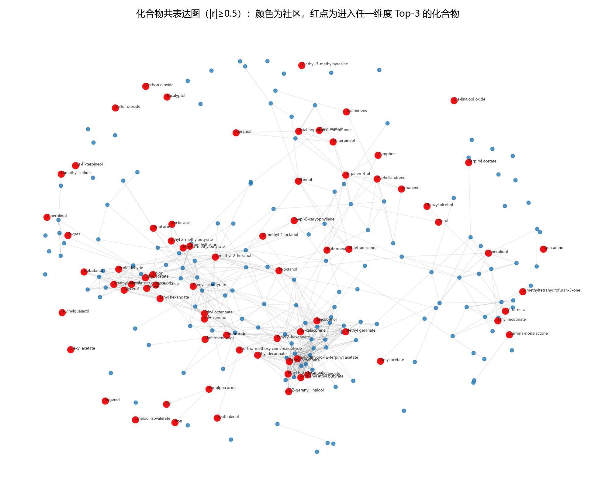
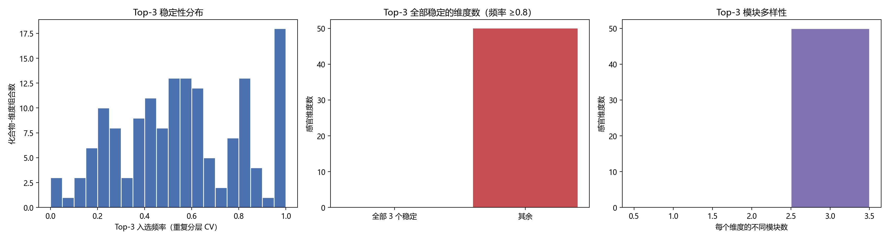
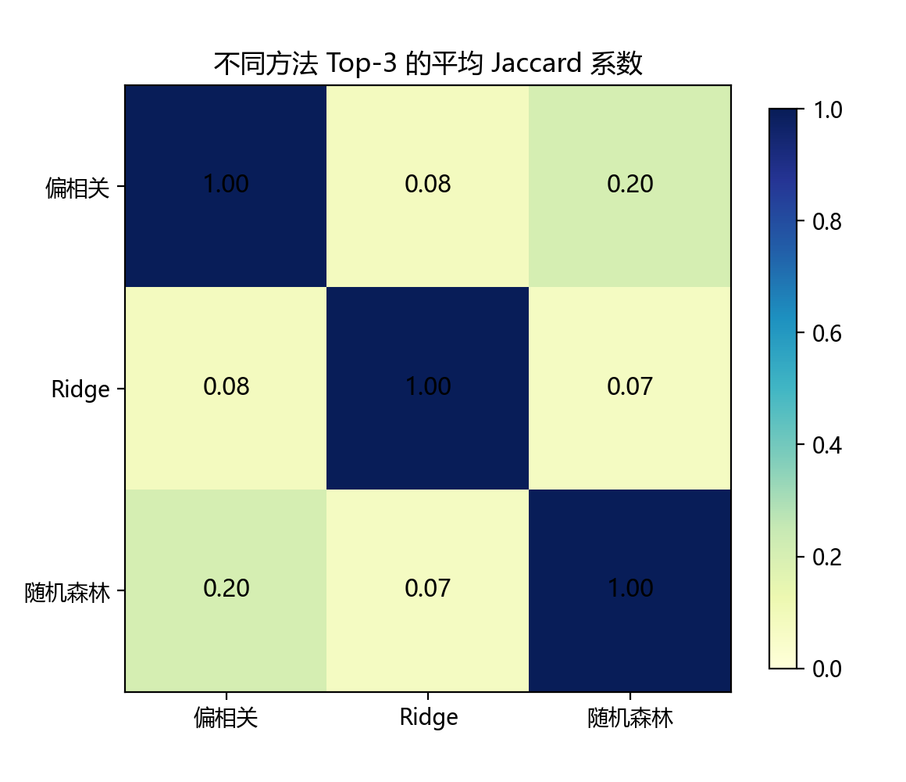
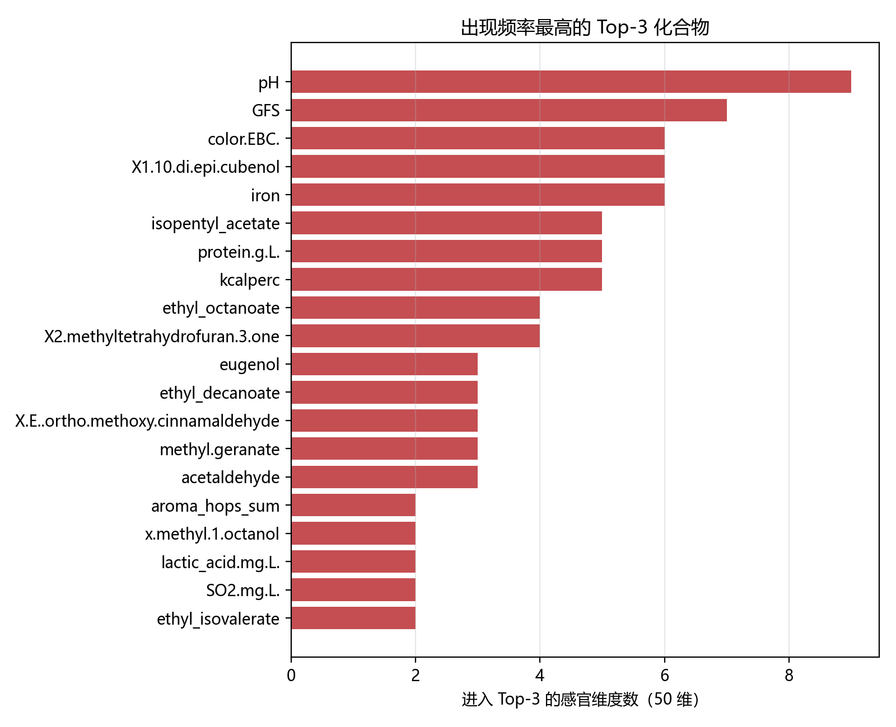

# 问题二：化合物–风味关键因素识别与稳定性

> 所属：论文正文“模型建立与求解”之问题二（按官方模板“求解思路 → 模型建立 → 模型求解与分析”组织；对应《妈妈提示词》第一~第三、第五~第八部分）。
> 数字来源：`成果/results/04_q2_Top3.csv`、`04_q2_模块重要性.csv`、`04_q2_证据汇总.json`；脚本：`成果/code/04_q2_top3.py`；图：`成果/figures/fig_q2_*.png`；随机种子 42。

---

## 1 问题二求解思路

问题二要求以 `2.csv` 的化合物相关矩阵构建共表达图，结合 `1.csv` 特征，为每个感官维度给出 **Top-3 关键因素化合物**，并从**稳定性**（重采样入选频率、跨方法一致性）与**化学合理性**两方面论证。该问的本质是“多指标下的排序与优选”，而不是对样品或化合物的数值预测；`2.csv` 只提供结构先验，不能当作独立外部数据（其与 `1.csv` 同源，见数据字典 4.2 节）。

主要难点有三：① 231 个化合物高度共线，单个变量重要性容易被“共表达的替身变量”分走——参考论文也明确指出 GBR 的 MDI/SHAP 会优先选择主效应最大的变量；② 250 个样品下 Top-3 的精确组成本身可能不稳定，需要量化而不是掩盖；③ “关键因素”必须经得起化学解释（来源、阈值、与官方交叉相关的一致性），不能只看统计排序。

据此，本文采用“**结构先验 + 多方法证据 + 模块多样性约束 + 稳定性选择 + 化学合理性核验**”的路线：

1. 由 `2.csv`（|Spearman| ≥ 0.5）构建共表达图，社区发现得到化合物模块，作为“不可同时入选”的多样性单位；
2. 对每个感官维度，综合四类证据：风格控制偏相关、Ridge 系数、随机森林基尼重要性、官方 `6.csv` 交叉相关；
3. 以各证据百分位的平均作为综合得分，施加“同一模块最多 1 个”的多样性约束后取 Top-3；
4. 用 5 折 × 5 次（25 次）重复分层重采样重估全部证据，统计 Top-3 入选频率与跨方法 Jaccard 系数；
5. 用阈值表、来源类别与官方 `6.csv` 符号一致性做化学合理性核验，并对“反直觉”结果专门讨论。

## 2 结构先验与证据构造

### 2.1 共表达图与模块

- 数据：`2.csv` 的 231×231 Spearman 相关矩阵（数据字典 4.2 节已核验其口径）；化合物名经 `8.xlsx/Sensory thresholds` 与数据字典映射到 `1.csv` 列名（231 个全部匹配）。
- 建图：仅保留 |r| ≥ 0.5 的边，得 **231 个节点、641 条边**；加权度均值 3.37、最大 17.88；贪心模块度社区发现得到 **60 个社区**，最大 6 个社区规模为 45、37、27、22、20、18（其余多为小模块或孤立点）。
- 含义：大模块对应酯类/萜类/醇类等共表达家族；模块作为 Top-3 的“多样性单位”，避免把一个家族里的多个高度相关化合物同时选为 3 个“关键因素”。

### 2.2 四类证据

| 证据 | 计算方式 | 作用与局限 |
| --- | --- | --- |
| 风格控制偏相关 | 对 22 个风格哑变量做线性残差化后计算 Pearson 相关（231×50） | 排除“风格混杂”造成的伪相关；线性、只反映边际关联 |
| Ridge 系数 | 231 个特征标准化后多输出 Ridge（α=10），取逐目标系数绝对值 | 稳定、可解释的线性监督重要性；对非线性不敏感 |
| 随机森林基尼重要性 | 逐感官维度训练 RF（300 棵，`max_features=sqrt`，`min_samples_leaf=2`），取基尼重要性 | 捕捉非线性/交互；对共线变量有“分摊”偏差（论文亦指出） |
| 官方 6.csv 交叉相关 | 44 个化合物 × 50 个感官的 Spearman 交叉相关，取绝对值 | 官方给出的外部证据；覆盖率仅 44/231，缺失时按可用证据平均 |

**综合得分**：每个证据先在 231 个化合物内转成 [0,1] 百分位，再对可用证据取平均；最终 Top-3 用“全量证据 + 25 次折内证据”的平均得分（bagged score）排序，以降低单次划分噪声。

## 3 模型建立

### 3.1 多样性约束的 Top-3 选择

对每个感官维度 $j$，令综合得分为 $s_{ij}$（化合物 $i$），按 $s_{ij}$ 从高到低扫描；若候选化合物的模块已被选中则跳过，否则入选，直到选满 3 个。若模块数不足 3 个，则回退为纯得分排序。该约束把“Top-3”从“三个高度相关的同族化合物”变为“三个不同共表达模块的代表”，更符合“关键因素”的解释目标，也直接回应参考论文指出的共线性重要性偏差。

### 3.2 稳定性量化

- **重采样**：按风格分层 5 折 × 5 个随机种子（42/1024/2024/7/99），共 25 次；每次只用训练折重估四类证据（官方 6.csv 作为外部证据保持不变）、重新计算综合得分与多样性 Top-3，统计每个化合物-维度组合的入选频率 $f$。
- **判定约定**：$f\ge0.8$ 记为“稳定”，$0.5\le f<0.8$ 记为“边缘”，$f<0.5$ 记为“不稳定”；同时报告“稳定核心”大小（$f\ge0.5$ 的化合物数）。
- **跨方法一致性**：对每个维度，计算偏相关/Ridge/RF/官方四类方法各自 Top-3 的两两 Jaccard 系数并取平均；Jaccard 越低说明不同方法给出的关键化合物越不一致。
- **模块级稳定性**：把模块内最高化合物得分作为模块得分，统计折内“模块得分前 3”的入选频率。

### 3.3 化学合理性核验

- 每个 Top-3 化合物标注：阈值表是否有该化合物及其阈值/单位（`8.xlsx/Sensory thresholds`）、来源类别（Yeast/Malt/Hops/Wild flora/Spices/Others）；
- 对同时出现在官方 `6.csv` 的化合物-维度对，检查官方交叉相关符号与本文风格控制偏相关符号是否一致；
- 对“同名化合物未入选”的维度（如 diacetyl、dms）做专门讨论，区分“统计关联”与“因果/阈值机制”。

## 4 模型求解与结果

### 4.1 共表达图结构

共表达图（图 1）显示：231 个化合物在 |r|≥0.5 下形成 60 个社区，其中 6 个大社区覆盖了大部分酯类、萜类与醇类化合物；红点为进入任一维度 Top-3 的化合物，集中在若干大社区与部分小社区（如 4VG、eugenol 等）中。大社区意味着“同族化合物高度共表达”，这也是必须做模块多样性约束的直接原因。

### 4.2 各维度 Top-3 结果（节选）

完整 50 维 Top-3（含综合得分、四类证据百分位、入选频率、模块、来源、阈值）见 `成果/results/04_q2_Top3.csv`；下表为代表性维度（数值为 bagged 综合得分前 3，括号内为 25 次重采样的入选频率）：

| 感官维度 | Top-1 | Top-2 | Top-3 | 化学解释 |
| --- | --- | --- | --- | --- |
| acidity（酸度） | Total acids（0.68） | pH（1.00） | Isoamyl acetate（0.56） | 总酸/pH 与酸感直接对应；异戊酯可能反映发酵与果香背景 |
| bitternes（苦度） | Ethyl octanoate（0.92） | Iso-alpha acids（0.64） | Ethyl decanoate（0.68） | 异α-酸是苦味主体；辛酸乙酯/癸酸乙酯为酵母酯类，与酒花/发酵状态共变 |
| alcohol（酒精感） | Caloric value（0.80） | N-octanol（0.96） | Spathulenol（0.08） | 热量值与酒精度强相关；辛醇为酵母高级醇；第三个为不稳定成分 |
| X4vg（4-乙烯基愈创木酚） | 4-vinylguaiacol（1.00） | Tau-cadinol（0.24） | Camphor（0.36） | **同名化合物稳定入选**（酚类香料/野生酵母标志）；另外两个为不稳定候选 |
| overall（总体喜好） | Unfermentables（0.84） | 2-butyl octanoate（0.52） | Cis-linalool oxide（0.28） | 残糖/酒体相关参数与总体喜好相关；酯类/萜类为风味协同因素 |
| dms（二甲基硫） | Protein（0.64） | E-nerolidol（0.64） | Sulfur dioxide（0.56） | DMS 阈值低、变异小；蛋白/硫代谢与萜类可能作为共变背景，**同名 DMS 未入选** |

从全表看，出现频率最高的 Top-3 化合物为 pH（9 个维度）、GFS/糖类（7）、color.EBC（6）、epi-cubenol（6）、iron（6）、isopentyl acetate（5）、protein（5）、kcal（5）、ethyl octanoate（4）等。**理化参数（pH、色度、糖、铁、热量）在多个感官维度中入选**，说明它们不仅是“背景变量”，而是与风味状态强共变的综合指标；而酯类/萜类（isopentyl acetate、ethyl octanoate、epi-cubenol、eugenol 等）则更多对应具体香气维度。

### 4.3 稳定性结果

25 次重采样下的稳定性统计（表 2）：

| 指标 | 数值 | 解释 |
| --- | ---: | --- |
| Top-1 平均入选频率 | **0.744** | 每个维度的“第一关键因素”相对稳定（25/50 维 ≥0.8） |
| Top-3 平均入选频率 | 0.556 | 第 2、3 位的精确组成本身不稳定 |
| 三维度全部 ≥0.8 的维度数 | 0/50 | 严格“三个都稳定”的维度不存在 |
| 最小频率 ≥0.6 / ≥0.5 的维度数 | 3 / 10 | 多数维度的第 3 位低于 0.5 |
| 稳定核心大小（频率 ≥0.5） | 平均 1.76 个 | 每维度平均有约 1.8 个“稳定关键化合物” |
| 模块级平均入选频率 | 0.709 | 模块层面的结论比化合物个体更稳定 |
| 跨方法平均 Jaccard | 0.167 | 偏相关/Ridge/RF/官方四法给出的 Top-3 差异很大 |
| 官方 vs 风格控制偏相关 | Pearson 0.560（2200 对） | 官方交叉相关与本文偏相关方向一致、强度中等 |

**解读**：Top-1 的稳定性（0.744）明显高于 Top-3（0.556），说明“哪个化合物最重要”相对可靠，而“第二、第三是谁”在 250 个样品与 231 个共线变量下具有本质不确定性。这与参考论文自述的共线性问题一致：当多个化合物高度共表达时，不同重采样会让“重要性”在家族内部重新分配。跨方法 Jaccard 仅 0.167 进一步说明，不同统计口径给出的关键化合物集合差异很大；模块级稳定性（0.709）明显高于化合物级，说明“哪些模块重要”比“模块内哪个化合物代表”更稳健。因此本文在给出化合物级 Top-3 的同时，把“稳定核心（频率 ≥0.5）+ 模块级结论 + 化学合理性”作为更可靠的交付口径。

### 4.4 化学合理性

- **来源可解释**：150 条 Top-3 记录中 146 条能映射到阈值表的来源类别（Yeast 41、Hops 38、Others 31、Malt 22、Spices 12、Wild flora 2、未标注 4），来源分布合理（酯类/高级醇来自酵母、萜类来自酒花、香料类来自 Spices）。
- **阈值可核对**：57 条记录有明确阈值（如 eugenol 阈值 25、4VG 阈值 0.206 mg/L、GFS 阈值 2.9 等），其余为无阈值文献的化合物；有阈值的 Top 化合物可用于问题三的“缺陷/香气强度”约束。
- **符号一致性**：在 77 个同时被官方 `6.csv` 覆盖的 Top 记录中，官方交叉相关符号与本文风格控制偏相关系数**全部一致（77/77）**，说明方向性结论可靠。
- **反直觉结果**：diacetyl、dms 两个“缺陷维度”的同名化合物均未入选 Top-3（diacetyl 维度 Top-3 为 pentyl octanoate、octyl acetate、ethyl octanoate；dms 为 protein、E-nerolidol、sulfur dioxide）。可能原因：① 商业啤酒中这些缺陷化合物浓度变异小、多数低于阈值，与感官评分的相关被压缩；② 缺陷评分可能受“整体风味状态”影响，与酯类/硫代谢背景共变；③ 阈值型关系使线性相关/RF 重要性低估。该现象本身是“相关≠因果、阈值型风味不宜只靠统计排序”的直接证据，也说明问题三必须用阈值硬约束而非只依赖重要性排序。

### 4.5 与参考论文的对比

| 方面 | 参考论文 | 本文问题二 |
| --- | --- | --- |
| 重要性方法 | GBR 的 MDI + SHAP（RateBeer 喜好模型） | 风格控制偏相关 + Ridge + RF Gini + 官方 6.csv 四类证据集成 |
| 共线性处理 | 作者自述 MDI/SHAP 会低估共相关变量，未给出系统方案 | 2.csv 社区模块 + 模块多样性约束 + 模块级重要性 |
| 稳定性 | 100 次重复建模看模型性能稳定性，未量化 Top-3 稳定性 | 25 次重采样入选频率 + 跨方法 Jaccard + 稳定核心 + 模块级稳定性 |
| 化学合理性 | 用文献知识讨论 SHAP 反直觉结果 | 来源/阈值/符号一致性量化 + 反直觉结果专门讨论 |
| 输出 | 重要性排名（Top 变量） | 每维度 Top-3（含稳定性标注）与模块级结论 |

## 5 小结与对后续问题的衔接

问题二的主要结论：① 共表达图存在明显的化合物家族结构（60 个社区），Top-3 必须做模块多样性约束，否则会把同族化合物重复选入；② **Top-1 关键因素相对稳定（平均频率 0.744），但 Top-3 精确组成本质不稳定（0.556），模块级结论更稳健（0.709）**；③ 化学合理性总体良好（来源 146/150、符号一致性 77/77），但 diacetyl/dms 等阈值型缺陷同名化合物未入选，说明统计关联不能替代阈值机制。

对后续问题的衔接：问题二识别出的**模块/稳定核心化合物**为问题三提供“必须约束或保留的化学特征”清单；4VG、eugenol、异α-酸等有阈值的 Top 化合物直接进入问题三的缺陷/香气约束；稳定性结论也提示问题三的生成评价不能只看单一准则，而要用“分布 + 代理感官 + 阈值 + 化学结构”多维评价。

---

### 附：问题二结果文件清单

| 文件 | 内容 |
| --- | --- |
| `成果/results/04_q2_Top3.csv` | 50 个感官维度 × Top-3 的完整结果（综合得分、四类证据百分位、入选频率、模块、来源、阈值、符号一致性） |
| `成果/results/04_q2_模块重要性.csv` | 60 个共表达模块 × 50 感官维度的 RF 模块重要性 |
| `成果/results/04_q2_证据汇总.json` | 图结构、稳定性、化学合理性、Top 化合物频次等汇总 |
| `成果/figures/fig_q2_stability.png` | 稳定性分布、全稳定维度数、模块多样性 |
| `成果/figures/fig_q2_method_jaccard.png` | 偏相关/Ridge/RF 的 Top-3 Jaccard 热图 |
| `成果/figures/fig_q2_graph_modules.png` | 共表达图与社区、Top-3 化合物标注 |
| `成果/figures/fig_q2_top_compounds.png` | 进入 Top-3 次数最多的化合物 |
| `成果/figures/fig_q2_consistency.png` | 官方交叉相关 vs 风格控制偏相关一致性 |
