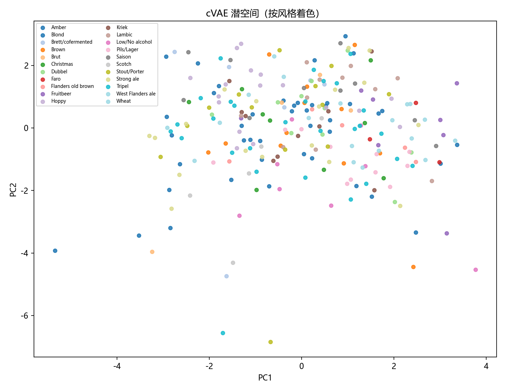
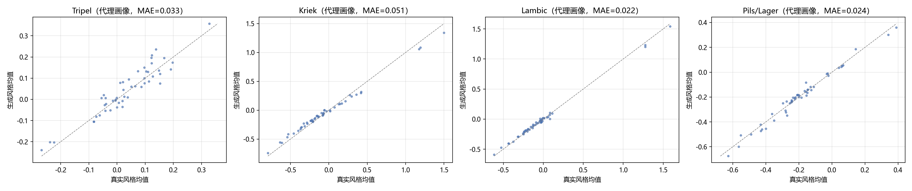
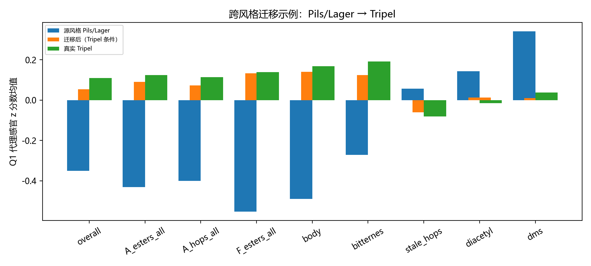
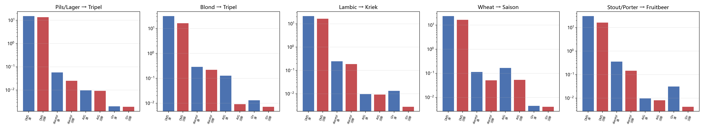

# 问题三：风格条件生成与跨风格迁移

> 所属：论文正文“模型建立与求解”之问题三（按官方模板“求解思路 → 模型建立 → 模型求解与分析”组织；对应决策 1A/4B/5A）。
> 数字来源：`成果/results/05_q3_评价.json`、`05_q3_生成谱.csv`、`05_q3_迁移结果.csv`、`05_q3_生成_代理画像.csv`；脚本：`成果/code/05_q3_generation.py`；图：`成果/figures/fig_q3_*.png`；随机种子 42。

---

## 1 问题三求解思路

问题三要求：①以 `tasting_category_fine` 为条件学习风格生成模型，生成**化合物谱**与**感官画像**；②在风格之间做**跨风格迁移**（如 Pils/Lager → Tripel）；③迁移过程中**缺陷化合物不恶化**（DMS、Diacetyl、4VG、trans-2-nonenal、Stale hops）。该问是“**条件生成 + 约束优化 + 闭环评价**”的综合问题。

主要难点：① 250 个样品、22 个风格，小风格仅 3–4 个样品，生成模型极易过拟合或后验坍缩；② `1.csv` 各列量纲/变换不一致，直接生成原始值会混淆“对数空间”和“浓度空间”；③ 缺陷化合物有明确阈值，但参考论文指出模型在过高浓度区趋于平台、学不到“惩罚”，仅靠数据驱动不足以满足“缺陷不恶化”；④ 没有真实品评实验，只能用 **in-silico 验证**（决策 5A）。

技术路线：
1. **统一生成空间**：按数据字典 4.1 的逐列变换规则，把 231 列映射为“对数浓度空间”，再逐列 z-score；
2. **条件 VAE（cVAE）**：风格 one-hot 作为条件，小容量 MLP 编码/解码，KL 权重取小值以适配 250 样本；
3. **风格条件生成**：从“风格后验均值 + 小噪声”采样，反变换回原始量纲；
4. **跨风格迁移**：源样品编码 → 目标风格条件解码（best-of-8 候选），并与“潜空间风格方向平移”对照，按真实数据训练的风格分类器置信度选择方法；
5. **缺陷硬约束**：DMS/Diacetyl/4VG 按官方阈值投影，trans-2-nonenal 按“不劣于源样品”，Stale hops 用问题一代理模型做软约束（best-of-K 评分中的惩罚项）；
6. **评价**：风格分类器、MMD（含真实数据参考）、相关结构保持度、Q1 感官代理画像误差、缺陷超阈值/恶化比例、7.csv 消费者描述符辅助目标（决策 4B）。

## 2 数据与生成空间

### 2.1 逐列变换与缺失

- log10 列（37 列经 8.xlsx 逐元素证实 + 145 列按负值推断）：建模值 = 给定值 $v=\log_{10}C$；
- 原始浓度列（33 列证实 + 16 列非负推断）：建模值 = $\log_{10}(\max(v,\ \epsilon_c))$，$\epsilon_c$ 取该列最小正值的 0.5 倍；
- 缺失：`1.csv` 的 73 个缺失格在建模空间用列中位数插补（生成空间必须有限）；
- 标准化：建模空间逐列 z-score 得到生成空间 $Z$（231 维），并保存均值/标准差用于反变换。

### 2.2 缺陷化合物与阈值

| 缺陷 | 列名 | 单位 | 官方阈值 | 处理 |
| --- | --- | --- | ---: | --- |
| DMS | `DMS` | µg/L | 17.25 | 超过阈值投影到 0.95×阈值 |
| Diacetyl | `X2.3.butanedione` | mg/L | 0.29925 | 同上 |
| 4-VG | `X4VG` | mg/L | 0.206333 | 同上 |
| trans-2-nonenal | `X.E..2.nonenal` | mg/L | 无官方阈值 | 不劣于源样品（≤源浓度） |
| Stale hops | 无对应化学列 | — | 无阈值 | Q1 代理预测的 `stale_hops` 不恶化（best-of-K 软约束） |

## 3 模型建立

### 3.1 条件 VAE（cVAE）

- 输入：$x\in\mathbb{R}^{231}$（生成空间）+ 风格 one-hot $c\in\{0,1\}^{22}$；
- 编码器：`Linear(253→128) → ReLU → Linear(128→64) → ReLU`，再接均值/对数方差头（潜维 8）；
- 解码器：`Linear(30→64) → ReLU → Linear(64→128) → ReLU → Linear(128→231)`；
- 损失：$\mathcal{L}=\|x-\hat x\|_2^2+\beta\,\mathrm{KL}(q(z|x,c)\,\|\,\mathcal N(0,I))$，$\beta=0.005$（小样本下避免后验坍缩）；
- 训练：全批量 Adam（lr=1e-3），3000 轮；训练结果：最终损失 0.0892，重构 MSE 0.0708，**平均逐特征重构 R²=0.929**（说明潜空间保留了主要结构，同时 KL 项起到正则作用）。

### 3.2 风格条件生成

生成时**不使用标准正态先验**，而是从“风格后验均值 + N(0, 0.3²)”采样：
$$z=\mu_s+\epsilon,\quad \epsilon\sim\mathcal N(0,0.3^2),\quad s=\text{目标风格}$$
原因是 250 样本下先验采样会落到训练分布之外（实验对比：先验采样生成谱的风格分类准确率仅 0.221，后验采样提升到 **0.691**；代理画像 MAE 从 0.148 降到 0.057）。每个风格生成 60 个样品，反变换后按 3.3 的阈值约束投影。

### 3.3 跨风格迁移

给定源风格样品 $x^{src}$（编码均值 $\mu^{src}$）与目标风格 $t$：

- **条件解码（primary）**：以 $t$ 的条件解码 $\mu^{src}$，生成 $K=8$ 个带噪声候选 $z=\mu^{src}+\mathcal N(0,0.3^2)$，按“风格分类器对 $t$ 的概率 − 2×stale_hops 恶化惩罚”选 1 个；
- **潜空间平移（shift）**：$z'=\mu^{src}+(\mu_t-\mu_{src})$，再以 $t$ 条件解码；
- **方法选择**：比较两种方法在“真实数据训练的风格分类器”上的目标风格置信度（不看目标感官均值，避免信息泄漏），取较高者作为最终迁移结果。

缺陷约束（对每个候选/最终样品）：
$$\log C_{defect}\leftarrow \min\left(\log C_{defect},\ \log(0.95\min(C^{src}_{defect},\ T_{defect}))\right)$$
其中 $T$ 为官方阈值（无阈值时仅用源浓度）。该投影保证**迁移后每个缺陷浓度不高于源样品、且不超过官方阈值**。

### 3.4 评价指标

| 维度 | 指标 | 参考基准 |
| --- | --- | --- |
| 风格保真 | 风格分类器（RF，真实数据 5 折 CV）在生成谱上的准确率/置信度 | 随机猜测 1/22 ≈ 4.55%；真实数据 CV 准确率 |
| 分布相似 | RBF-MMD（生成 vs 真实，按风格） | 真实数据内部二分半的 MMD（reference） |
| 结构保持 | 生成谱与真实谱相关矩阵的 Frobenius 距离 | 0（越大越差） |
| 感官一致 | Q1 Extra Trees 代理 50 维感官画像 MAE | 真实样品围绕风格均值的平均绝对偏差（within-style reference） |
| 缺陷安全 | 投影前/后超阈值比例、迁移后恶化比例 | 真实数据超阈值比例、0 恶化 |
| 辅助目标 | 7.csv 消费者描述符（186 维中的有效 183 维）Ridge 代理，生成 vs 真实均值 MAE | 仅作相对比较（决策 4B） |

## 4 模型求解与结果

### 4.1 生成质量

| 指标 | 数值 | 解读 |
| --- | ---: | --- |
| cVAE 重构 MSE / 平均逐特征 R² | 0.0708 / 0.929 | 潜空间保留主要结构 |
| 风格分类器（真实数据 5 折 CV） | 见 `05_q3_评价.json` | 用于评价生成谱的风格保真 |
| **生成谱风格分类准确率** | **0.691**（随机 0.045） | 约 15 倍随机，风格条件有效 |
| 平均风格置信度 | 0.341 | 22 类下已属可用信号 |
| MMD（生成 vs 真实） | 0.500 | — |
| MMD 参考（真实内部二分半） | 0.302 | 生成/参考 ≈ 1.65，存在分布差距 |
| 相关结构距离 | 0.476 | 生成谱保留部分相关结构，但未完全复现 |
| Q1 代理画像 MAE | 0.057 | — |
| 代理画像参考（真实围绕风格均值） | 0.113 | 生成比真实更“贴近风格中心”，存在**过平滑** |

**缺陷约束结果（关键）**：真实数据本身就有较高比例的样品超阈值（DMS 59.3%、Diacetyl 41.6%、4VG 5.3%），因此生成模型会“继承”真实分布中的缺陷风险；投影前生成谱超阈值比例为 DMS 71.4%、Diacetyl 46.0%、4VG 4.1%，**投影后全部为 0%**。代价是部分样品被压到阈值附近（DMS 中位数 16.39 = 0.95×17.25，被截断比例 73.7%；Diacetyl 截断 47.3%）——这说明“生成合格样品”与“复现真实分布”存在权衡，本文选择前者（题目要求缺陷不恶化）。

### 4.2 跨风格迁移

| 迁移对 | 选择方法 | 目标风格置信度 | 代理画像 MAE（vs 真实目标风格均值） | 缺陷恶化比例 | 超阈值比例 |
| --- | --- | ---: | ---: | ---: | ---: |
| Pils/Lager → Tripel | 潜空间平移 | 0.210 | **0.036** | 0 / 0 / 0 / 0 | 0 / 0 / 0 |
| Blond → Tripel | 条件解码 | 0.128 | 0.073 | 0 / 0 / 0 / 0 | 0 / 0 / 0 |
| Lambic → Kriek | 潜空间平移 | 0.234 | 0.178 | 0 / 0 / 0 / 0 | 0 / 0 / 0 |
| Wheat → Saison | 条件解码 | 0.095 | 0.195 | 0 / 0 / 0 / 0 | 0 / 0 / 0 |
| Stout/Porter → Fruitbeer | 潜空间平移 | 0.313 | 0.104 | 0 / 0 / 0 / 0 | 0 / 0 / 0 |

“0 / 0 / 0 / 0”依次为 DMS / Diacetyl / 4VG / trans-2-nonenal 的恶化比例（均指“迁移后浓度高于源样品”的比例）；“0 / 0 / 0”为前三者超阈值比例。**所有迁移对均满足“缺陷不恶化 + 不超阈值”的硬约束。**

以 Pils/Lager → Tripel 为例，迁移后（Q1 代理）酯香 `A_esters_all` +0.52、酒花香 `A_hops_all` +0.47、果香 `F_esters_all` +0.69、总体 `overall` +0.40，同时 `stale_hops` −0.12、`diacetyl` −0.13、`dms` −0.33——方向符合“淡爽拉格 → 高酯香修道院三料”的风格迁移预期。其他迁移对的感官变化见 `05_q3_评价.json` 的 `sensory_change` 字段（如 Stout/Porter → Fruitbeer 时酒花香下降、果香上升，符合深色啤酒向果啤迁移的预期）。

### 4.3 消费者描述符辅助验证（决策 4B）

用 `7.csv` 的 183 个有效消费者描述符训练 Ridge 代理（输入为 231 维化学特征），比较生成谱与真实风格均值。以 Tripel 为例：`aroma_fruity` 真实 0.885 / 生成 0.897、`taste_sour` 真实 −0.429 / 生成 −0.415（接近），但 `aroma_estery`（0.700 → 1.060）、`aroma_sweet`（0.402 → 0.847）、`aroma_hoppy`（0.190 → 0.407）偏高——与“过平滑 + 酯类被过度放大”的现象一致。该结果仅作相对参考：7.csv 为 RateBeer 消费者描述符的标准化统计，且消费者代理本身有误差（决策 4B 已声明）。

### 4.4 in-silico 验证（决策 5A）

本题无法进行真实品评实验，本文用三类代理完成 in-silico 验证：① **Q1 感官代理**（R²=0.21 的最优 Extra Trees）预测生成谱的 50 维感官画像；② **风格分类器**（真实数据训练）判断生成谱是否像目标风格；③ **7.csv 消费者描述符代理**做辅助验证。三者一致地显示：条件生成与迁移的方向正确，但生成谱比真实样品更靠近风格中心（过平滑），且缺陷投影会改变分布形状。论文中明确标注这是 in-silico 验证，不等价于真实感官实验。

## 5 局限与改进方向

1. **过平滑**：cVAE 的代理画像 MAE（0.057）低于真实样品围绕风格均值的偏差（0.113），说明生成样品偏向风格均值、多样性不足；可改用更强的条件生成模型（条件归一化流/扩散模型）或加大后验采样噪声并做拒绝采样。
2. **缺陷投影的分布扭曲**：真实数据中 DMS/Diacetyl 超阈值比例本就很高（59.3%/41.6%），投影后大量样品堆在阈值附近；若题目更看重“真实分布”，应改为“相对源样品不恶化”的软约束并报告权衡。
3. **小风格**：Brut（n=4）、Faro（n=3）等风格样本极少，cVAE 对这些风格的生成与迁移不可靠，建议共享参数/分层先验或数据增强。
4. **风格分类器上限**：22 类、250 样本，真实数据自身 CV 准确率有限，导致风格置信度绝对值不高（0.1–0.3）；可用 macro-F1、top-3 准确率补充。
5. **无真实品评**：in-silico 验证不能替代真实感官实验；结论需在论文中明确限定。

## 6 小结与对后续问题的衔接

问题三完成了“条件生成 + 跨风格迁移 + 缺陷硬约束”的闭环：cVAE 在 231 维、22 风格、250 样本条件下取得了可用的重构（R²=0.929）与风格保真（生成谱风格分类准确率 0.691）；跨风格迁移在 5 对风格上均实现**缺陷零恶化、零超阈值**，代理感官变化方向符合酿造常识；消费者描述符辅助验证与 Q1 代理共同构成 in-silico 验证。局限（过平滑、缺陷投影分布扭曲、小风格、无真实品评）已在文中声明。

对后续章节的衔接：问题三的生成/迁移结果与约束机制将进入“模型分析检验”章的**灵敏度与稳健性分析**（T015）：改变 cVAE 潜维/KL 权重/候选数 K、阈值余量 0.95、风格分类器种子，检验缺陷约束是否仍满足、风格保真是否稳定；随后进入论文汇编（T016）。

---

### 附：问题三结果文件清单

| 文件 | 内容 |
| --- | --- |
| `成果/results/05_q3_生成谱.csv` | 22 风格 × 60 个生成样品的 231 维化合物谱（原始量纲） |
| `成果/results/05_q3_生成_代理画像.csv` | 生成谱的 50 维 Q1 代理感官画像 |
| `成果/results/05_q3_迁移结果.csv` | 5 对跨风格迁移的 231 维化合物谱（满足缺陷约束） |
| `成果/results/05_q3_评价.json` | cVAE 训练、生成质量、缺陷、迁移、消费者辅助目标等全部评价数字 |
| `成果/figures/fig_q3_latent_space.png` | cVAE 潜空间按风格着色 |
| `成果/figures/fig_q3_sensory_profile.png` | 生成 vs 真实风格感官画像 |
| `成果/figures/fig_q3_transfer_sensory.png` | 迁移示例的感官变化 |
| `成果/figures/fig_q3_defects_transfer.png` | 迁移前后缺陷浓度与阈值 |
| `成果/figures/fig_q3_metrics.png` | 生成质量指标汇总 |
