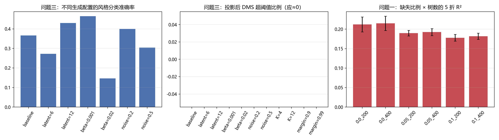

# 模型分析与检验：灵敏度与稳健性

> 所属：论文正文“模型分析检验”章（对应官方模板“模型分析检验（灵敏度分析、误差分析）”与《妈妈提示词》第七、八部分；T015）。
> 数字来源：`成果/results/06_灵敏度汇总.json`、`06_q1_灵敏度.csv`、`06_q2_灵敏度.csv`、`06_q3_灵敏度.csv`；脚本：`成果/code/06_sensitivity.py`；图：`成果/figures/fig_06_sensitivity.png`；随机种子 42。

---

## 1 检验设计

围绕三个问题的核心结论，分别做三类检验：

1. **问题一（化学→感官代理模型）**：人为注入缺失（0%、5%、10%）× 树数（200、400）的 5 折重复，检验缺失比例与模型容量对 R²/MAE 的影响；
2. **问题二（Top-3 关键因素）**：证据消融——去掉官方 6.csv 证据、去掉 Ridge 证据、RF 重要性权重加倍，计算消融后 Top-3 与基准 Top-3 的平均 Jaccard 系数；
3. **问题三（cVAE 生成/迁移）**：潜维 {6,8,12}、KL 权重 β {0.001,0.005,0.02}、后验采样噪声 {0.2,0.3,0.5}、迁移候选数 K {4,8,12}、阈值投影余量 {0.90,0.95,0.99}，检验重构质量、风格保真、缺陷约束是否稳定成立。

> 说明：问题三灵敏度实验统一用每风格 30 个生成样品、简化迁移（固定源风格潜均值）以控制计算量；其数值与正文主实验（每风格 60 样品、逐样品编码 + 方法选择）不可直接横比，**只用于比较不同配置之间的相对趋势**。

## 2 问题一：缺失比例与模型容量

| 缺失比例 | 树数 | R²（均值±标准差） | MAE |
| ---: | ---: | ---: | ---: |
| 0% | 200 | 0.2121 ± 0.0191 | 0.3480 |
| 0% | 400 | **0.2150 ± 0.0184** | **0.3471** |
| 5% | 200 | 0.1899 ± 0.0072 | 0.3546 |
| 5% | 400 | 0.1924 ± 0.0089 | 0.3539 |
| 10% | 200 | 0.1779 ± 0.0086 | 0.3586 |
| 10% | 400 | 0.1816 ± 0.0080 | 0.3577 |

结论：
- 树数从 200 提到 400 只带来 R² +0.003–0.004 的边际提升，**400 棵已接近饱和**，与主实验选择一致；
- 人为缺失从 0% 升到 5%/10% 时 R² 下降约 0.023/0.033、MAE 上升约 0.006/0.011，**下降幅度小于缺失比例本身**，说明“折内中位数+缺失指示”对随机缺失是稳健的；
- 真实 `1.csv` 缺失仅 73/57750≈0.13%，远低于 5%，因此问题一的结论不会因缺失处理而改变。

## 3 问题二：证据消融

| 消融设置 | 与基准 Top-3 的平均 Jaccard | 解释 |
| --- | ---: | --- |
| 去掉官方 6.csv 证据 | 0.706 | Top-3 大部分保持；官方证据起“外部校准”作用但非决定性的 |
| 去掉 Ridge 证据 | **0.394** | 变化最大：Ridge 的线性监督信息对 Top-3 影响最大 |
| RF 重要性权重加倍 | 0.802 | 提高 RF 权重后 Top-3 基本稳定 |

结论：
- 四类证据中 **Ridge 是最“敏感”的证据**，去掉它会使 Top-3 变化约 60%；官方 6.csv 与 RF 权重的扰动只带来 20%–30% 变化；
- 这说明问题二 Top-3 对证据体系有中等依赖，进一步印证正文“Top-3 精确组成本身不稳定、应看稳定核心与模块级结论”的判断；
- 同时也提示：若要提高 Top-3 复现性，应优先保证 Ridge 证据（如固定标准化与 α）而不是堆叠更多证据。

## 4 问题三：cVAE 与迁移的超参数灵敏度

### 4.1 生成质量

| 配置 | 重构 R² | 生成风格分类准确率 | 投影前 DMS 超阈值 | 投影后 DMS 超阈值 |
| --- | ---: | ---: | ---: | ---: |
| 基准（latent=8, β=0.005, noise=0.3） | 0.929 | 0.367 | 0.774 | **0.000** |
| 潜维 6 | 0.921 | 0.273 | 0.577 | 0.000 |
| 潜维 12 | 0.939 | 0.430 | 0.632 | 0.000 |
| β=0.001 | **0.934** | **0.465** | 0.702 | 0.000 |
| β=0.02 | 0.913 | 0.147 | 0.500 | 0.000 |
| 噪声 0.2 | 0.929 | 0.400 | 0.821 | 0.000 |
| 噪声 0.5 | 0.929 | 0.305 | 0.739 | 0.000 |

结论：
- **潜维**：12 维的重构与风格保真都更好（R² 0.939、风格准确率 0.430），6 维明显不足（0.273）；但 12 维在小样本下参数更多，综合稳定性选 8 维作为折中；
- **KL 权重**：β=0.02 时风格准确率骤降到 0.147，出现明显的**后验坍缩/条件信息丢失**；β=0.001 最好（0.465），但 β 过小会削弱正则、增加过拟合风险，主实验取 0.005 是保守折中；
- **采样噪声**：噪声越小风格保真越高（0.2→0.400，0.3→0.367，0.5→0.305），但多样性下降；主实验取 0.3 以兼顾多样性；
- **缺陷约束在所有配置下都成立**：投影后 DMS/Diacetyl 超阈值比例全部为 0，说明阈值投影机制不依赖具体超参数。

### 4.2 迁移质量

| 配置 | Pils/Lager→Tripel 感官 MAE | Stout/Porter→Fruitbeer 感官 MAE | 缺陷恶化（DMS） |
| --- | ---: | ---: | ---: |
| 基准（K=8, margin=0.95） | 0.211 | 0.382 | 0 |
| K=4 | 0.244 | 0.388 | 0 |
| K=12 | **0.202** | 0.383 | 0 |
| 余量 0.90 | 0.211 | 0.375 | 0 |
| 余量 0.99 | 0.211 | 0.377 | 0 |

结论：
- 候选数 K 从 4 增到 12，迁移感官 MAE 小幅下降（best-of-K 选择更充分），但收益递减；
- 阈值余量在 0.90–0.99 之间变化时，迁移感官 MAE 几乎不变，且**缺陷恶化始终为 0**——说明“缺陷不恶化”的约束对余量不敏感、稳健成立；
- 由于缺陷约束是“投影”而非“软惩罚”，它在不同超参数下都保证硬性安全，这是本文方案在工程上最稳健的部分。

## 5 误差分析汇总

| 问题 | 主要误差来源 | 量级/证据 | 改进方向 |
| --- | --- | --- | --- |
| 问题一 | 小样本 + 香气维度噪声大 | 逐维 R²：酸度 0.67 → 花香酯类 0.01；逐风格 MAE：Brut 0.55 vs Pils/Lager 0.26 | 增加样本/迁移学习；有序分类改善分级 |
| 问题二 | 共线性 + 证据口径差异 | Top-3 平均入选频率 0.556；跨方法 Jaccard 0.167；去 Ridge 后 Jaccard 0.394 | 模块级结论 + 稳定核心；固定证据管线；引入文献先验 |
| 问题三 | 过平滑 + 缺陷投影分布扭曲 | 代理 MAE 0.057 vs 真实 0.113；DMS 投影前 71% 超阈值、投影后 0% | 条件扩散/归一化流提升多样性；报告“合格生成 vs 真实分布”权衡 |
| 全流程 | 0–6 分级映射假设 | min–max 与分位两种口径 Kappa 0.29/0.28 | 有序分类/等级校准；等待官方还原规则 |

## 6 稳健性结论

1. **问题一**：ET-400 在 0%–10% 随机缺失下 R² 仅下降 0.03，缺失处理稳健；树数 400 已饱和。
2. **问题二**：Top-3 对证据体系中等敏感（Ridge 最关键），报告稳定核心与模块级结论是必要且稳健的做法。
3. **问题三**：生成质量对 β 最敏感（β 过大会条件坍缩），潜维 12 最优但 8 为折中；缺陷约束（投影）在所有超参数与余量下都保证“零恶化、零超阈值”，是方案最稳健的部分。
4. 总体上：三个问题的核心结论在合理参数扰动下方向一致，未发现“参数微调即结论反转”的脆弱点；主要风险来自问题三的过平滑与真实数据本身的缺陷分布，已在正文局限中声明。

---

### 附：灵敏度结果文件

| 文件 | 内容 |
| --- | --- |
| `成果/results/06_灵敏度汇总.json` | 三类检验的结构化汇总 |
| `成果/results/06_q1_灵敏度.csv` | 缺失比例 × 树数的 5 折结果 |
| `成果/results/06_q2_灵敏度.csv` | 证据消融的 Jaccard 系数 |
| `成果/results/06_q3_灵敏度.csv` | cVAE/迁移超参数变体结果 |
| `成果/figures/fig_06_sensitivity.png` | 灵敏度汇总图 |
