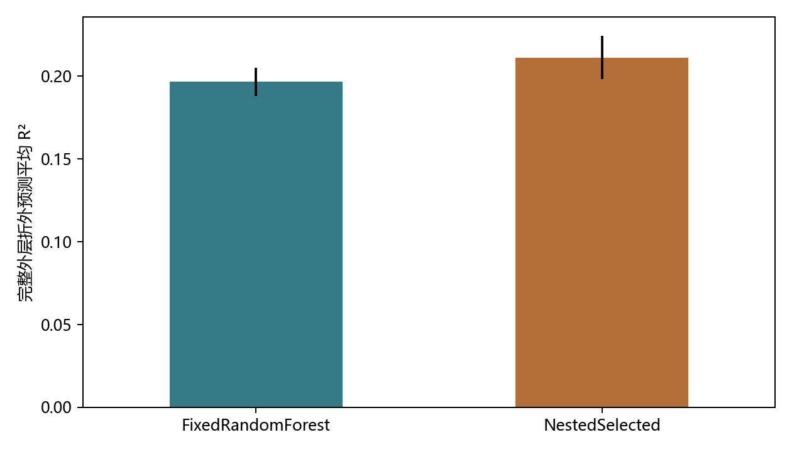
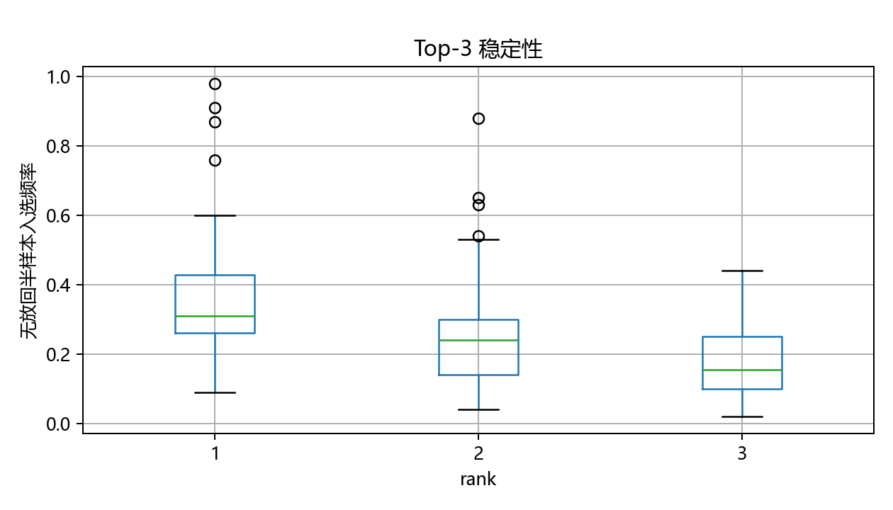
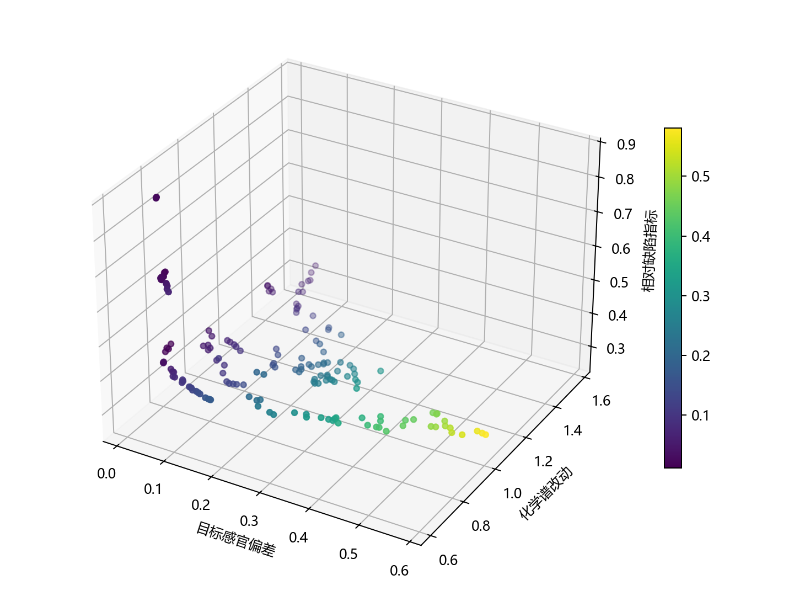

啤酒感官预测与受约束风格迁移

结合外部数据与文献证据的多目标决策研究

## 摘要

针对化学测量、专业感官评分与消费者评论具有不同数据尺度和采样机制的问题，本文在250款啤酒、231个化学与理化特征及50个感官响应上，构建带有证据审计的预测、归因、生成和多目标决策流程。外部啤酒评论数据只作风格趋势对照，不充当化学测量或专业品评标签。

针对问题一，采用折内缺失及重复底值状态处理，引入秩正态偏最小二乘与树模型候选。外层三折重复三次评价完整选型过程，内层三折选择模型。嵌套程序的完整折外预测平均R²为0.2113、MAE为0.3547；同划分固定随机森林的R²为0.1966。输出0至6相对等级，但不宣称恢复原始绝对评分。

针对问题二，保留固定共表达网络的原三方法结果作为对照，新增风格残差秩关联选择器及100次无放回近似分层半样本诊断。150个候选中有4项频率达到0.8；通过未见标签的验证特征近邻供体估计条件置换重要性，明确相关变量、候选选择规则及固定图的局限。

针对问题三，复用已训练条件VAE比较三种采样方式，另对条件收缩高斯及两个经验基准进行分层留出分布检验。尺度审计发现70列有标定对照，其中38列在可比正值行中一致、32列存在局部不一致。迁移将已核实正浓度约束和分析尺度非恶化分开，实际运行三次8维潜空间NSGA-II搜索，获得163个近似Pareto候选。

不同偏好下的决策体现目标感官接近度、化学画像改动与相对缺陷指标之间的取舍。数值约束及代理模型结果仅用于计算机筛选，不替代加标品评或酿造验证。本文的改进首先在于验证隔离、证据标注与可追溯决策，不以增加算法数量代替性能和实验依据。

关键词  嵌套验证  条件重要性  稳定性选择  条件生成  Pareto决策

## 一 问题与研究范围

赛题要求由化学谱预测感官评分、识别各感官属性Top-3因素，以及在风格条件下生成化学谱并完成缺陷不恶化的迁移。本文保留外部数据修订版的数据对齐和风格语义映射，并在其基础上重新实现可被文献支持的验证与优化模块。三问之间传递的是预测模型及候选证据，不是已经验证的因果关系。

用户提供方法稿[1]强调折内尺度处理、重复底值状态与约束证据分层；Schreurs等[2]在真实商业啤酒上比较多类模型并开展加标品评。本文进一步参考模型选择偏差[3]、条件重要性[4]、稳定性选择[5]、条件生成[6]和NSGA-II[7]，分别改善统计验证、解释可靠性及决策透明度。

原稿[2]的175/75分层训练测试及五折选参，与本文重复嵌套验证不同；其盲评加标结果是该研究自身的实验，不能作为本文候选产品已经改善的证据。[1]为用户提供的方法稿，未核实其作者和公开发表状态，本研究不把它等同于已同行评审成果，也不搬用其数值。

## 二 数据尺度与证据

### 2.1 样本连接与来源

表1 数据与分析角色

| 来源 | 规模 | 角色 |

| --- | --- | --- |

| 附件1与4 | 250款、231特征、50响应 | 按唯一beer连接并核对风格 |

| 附件2 | 231维相关结构摘要 | 固定网络先验，非独立新样本 |

| 附件3 | 空白评分卡及汇总 | 定义评分维度，不能从缓存零造标签 |

| 附件8 | 70列有可比标定 | 逐元素尺度与单位证据 |

| 外部数据 | 5558款、1498个酒厂 | 评论词频和风格背景，不与专业标签拼接 |

主数据有187个完整案例，其他样本保留并在训练折内插补。输入以SHA256固定。未把同一啤酒的50个感官维度视为50个独立样本，也未以发生精度损失的长商品编号强行匹配外部产品。

### 2.2 尺度账本与局部不一致

对每个有标定的字段，在参考浓度为正且双方非缺失的行上，逐一比较恒等、常用对数及自然对数关系。只有至少五个可比行且全部误差不超过1e-6，才记为正值行已核实；中位数误差接近零不能掩盖少量不一致。该证据不覆盖零值替代机制，也不证明不同版本数据完全一致。

表2 四类缺陷的尺度证据

| 字段 | 候选变换 | 不一致条数 | 本次约束口径 |

| --- | --- | --- | --- |

| DMS | log10 | 0 | 正值域浓度及阈值 |

| X2.3.butanedione | raw | 3 | 仅附件分析值非恶化 |

| X4VG | log10 | 0 | 正值域浓度及阈值 |

| X.E..2.nonenal | raw | 2 | 仅附件分析值非恶化 |

DMS和4VG的可比正值支持log10转换；双乙酰和反式2壬烯醛虽多数支持原值口径，却存在局部不一致，本次不以“多数一致”宣称全部物理浓度已验证。后两项继续采用附件值非增加约束，不对其未知或未完全核实尺度作完整化学阈值保证。DMS的17.25 µg/L和4VG的0.206333333 mg/L来自附件参考表，属于风味参考值，不是法定安全限值。

### 2.3 缺失与重复底值

参考[1]第5页，显式NA以训练中位数插补并附缺失标记；当某列训练最小值至少重复三次时，另构造底值状态标记。重复最低值不是已知仪器检出限，不随机抖动也不直接当作真实浓度。验证样本只按训练规则变换，不能重新估计中位数、底值或经验分布。

秩正态候选使用训练经验中秩u=(小于当前值的个数+等于值的个数/2)/训练非缺失数，并以1/(2n)截断概率后映射到标准正态分位。它是一种稳健预测尺度，不是对全部字段重复施加化学对数。

## 三 问题一 感官预测与验证隔离

### 3.1 候选模型与完整选型程序

候选预先固定为均值、3或8成分的秩正态PLS、秩正态Ridge、随机森林和极端随机树。PLS在相关响应间共享低维结构；两个树模型各160棵，分别使用最小叶样本3和2、平方根特征抽样。Ridge强度固定1000。所有候选均保留NA和重复底值状态，PLS与Ridge另执行训练内标准化。

根据[3]，选择模型本身属于训练。外层按风格分三折、使用42、1024和2024三个种子重复，内层在外层训练集上打乱三折比较多响应均方误差。内层采用普通K折，是因为稀有风格进一步划分后可能不足三例。每次内层拟合都独立重建预处理；外层响应不参与选型。最终评价对象是这套预声明选型程序。

每个重复拼接完整的250行折外预测后，按各感官目标计算R²、MAE和Spearman，再跨目标与重复汇总。折间结果、逐目标结果及各外层内层选择明细均保存。跨重复标准差只描述划分波动，不是九个独立试验的置信区间。

表3 同划分外层折外预测结果

| 程序 | R² | MAE | Spearman |

| --- | --- | --- | --- |

| FixedRandomForest | 0.1966 | 0.3567 | 0.4012 |

| NestedSelected | 0.2113 | 0.3547 | 0.3970 |

本次嵌套程序相对固定随机森林的平均R²差为0.0148。该差异来自同划分的两套程序，但本研究没有据此进行未经设计的显著性宣称。原修订版固定模型比较中随机森林折均R²为0.2024，其汇总尺度和本次完整OOF汇总不同，不能直接把两者之差全归因于算法提高。

表4 外层训练内部选择次数

| 候选 | 次数 |

| --- | --- |

| RankPLS8 | 5 |

| RankRidge | 4 |

### 3.2 相对等级与误差传播

附件4是标准化连续响应，评分卡不提供原始逐人0至6校准锚点。因此论文首先报告连续响应的可检验误差，再输出训练响应经验分位划成七档的相对等级。全样本拟合表只用于描述已知样品，不用拟合等级一致率证明绝对评分恢复。后续真实品评应记录原始逐人评分及标准化参数。

50个属性中有49个的重复外层平均R²大于零，stale_hops为0.0485。尤其第三问使用感官代理作为约束时，必须同时公开该属性的泛化能力；数值不恶化不等于真实品评不恶化。

## 四 问题二 相关化合物与稳定性

### 4.1 保留原结果并引入可核查对照

原修订版融合风格控制残差相关、Ridge系数与逐属性树重要性，且Top-3来自不同图社区。本次保留该表及原Bootstrap结果；参考[1]排除13项宏观与派生汇总量，在218项单项化学候选内新增秩正态风格残差关联选择器。第一问预测仍可使用全部231项信息，但不能把糖类总量或派生酯类汇总冒充可直接干预的单一分子。新选择器用于诊断对照，不宣称自动优于原三证据融合。

新选择器与原三方法Top-3的逐属性平均Jaccard为0.1040。名单变化提示选择规则敏感，不能仅因更换选择器后频率提高便称化学机制更可靠。固定附件网络仍来自全样本摘要，所以所有结果均条件于该图，未构成独立网络验证。

### 4.2 条件重要性

Strobl等[4]指出，在相关预测变量上，普通随机置换可能破坏协变量依赖并扭曲重要性。本次只用每个训练折选择Top-3及至多五个绝对相关大于等于0.3的上下文变量，再在验证特征的上下文空间寻找八个近邻供体，整体替换该分子的原值，由管线重算其NA和底值状态。

分别进行三次局部供体置换及普通置换，计算逐目标MSE相对未置换预测的增量，并保留负值。供体选择不读取验证响应。该近邻方法是本地条件分布的近似，不是[4]按树切点分组的精确实现，不能当作条件随机化检验或因果效应。

表5 条件与普通置换的描述性结果

| 指标 | 结果 |

| --- | --- |

| 目标化合物组合数 | 376 |

| 条件置换平均MSE增量 | 0.0001 |

| 普通置换平均MSE增量 | 0.0004 |

| 条件增量为负的组合数 | 173 |

### 4.3 无放回半样本稳定性

参考[5]，重复100次在各风格内无放回抽取约一半样本，稀有风格至少保留一个，每次重估插补、经验秩、风格残差与Top-3。它与原有有放回Bootstrap不同。由于逐风格取整，样本数并非严格总样本的一半；故这里只借鉴子样本选择概率思想，不套用其原理论的误选数界。

新诊断Top-3平均频率为0.2670，达到0.8的条目为4/150；有限重复的最坏Monte Carlo标准误约0.0500。频率只反映当前样本、固定图和选型规则的稳定性，不是化合物为真因子的概率。

表6 代表属性的诊断Top-3及半样本频率

| 属性 | 候选及频率 |

| --- | --- |

| A_esters_all | isopentyl_acetate (0.45)；neryl.propanoate (0.27)；phenethyl_alcohol (0.22) |

| F_hops_all | ethyl_octanoate (0.40)；ethyl_decanoate (0.24)；octyl_acetate (0.18) |

| dms | X.Z..dihydro.apofarnesal (0.25)；E.nerolidol (0.12)；X2.undecanone (0.26) |

| stale_hops | n.nonanol (0.31)；linalool.isovalerate (0.27)；alloaromadendrene.epoxide (0.13) |

| overall | X.E.E..2.4.decadienal (0.18)；cis.linalool.oxide (0.19)；linalool.isovalerate (0.28) |

## 五 问题三 条件生成与分布检验

### 5.1 条件变分模型的继承范围

复用外部数据修订版已保存的8维条件VAE和其插补、标准化参数。编码器以化学谱和风格输出mu及logvar，解码器以潜变量和风格输出化学画像。与[6]一般的条件先验网络不同，原模型KL项使用标准正态先验；拼接风格本身不能被写成已学习条件先验。

本次不重新训练cVAE，使用限制可加载类型的NumPy推理器读取项目自身的float32权重，计算确定性线性层和ReLU。原模型完整数据重构仅为训练内诊断；没有把它称为留出验证。原修订版三折cVAE留出误差较大，仍保留作为当前生成器泛化不足的证据。

### 5.2 后验不确定性与三种采样

根据[6]的重参数化形式，新增z=mu+exp(logvar/2)*epsilon，与原有后验均值加固定0.2噪声及标准正态采样并列。前者反映已学习编码后验的不确定性，后两者分别是经验扰动及先验对照；任一方式都不能仅凭高风格识别率证明分布真实。

表7 固定cVAE的内部采样诊断

| 采样 | 风格一致率 | 秩空间方差 | 最近真实谱RMS |

| --- | --- | --- | --- |

| posterior_mean_noise | 0.8871 | 1.0491 | 0.9064 |

| posterior_reparameterized | 0.9030 | 0.9675 | 0.8530 |

| standard_normal_prior | 0.2106 | 1.0866 | 1.2623 |

每种风格各生成60条并记录最近真实样品距离与近重复率。方差为组内诊断平均，不能与包含风格间差异的总体方差混称。生成谱明确带generated_style标识；它们是模型输出，不是新增观测，未被回灌为第一问监督标签。

### 5.3 分层留出分布基准

借鉴[1]第21至23页，在每个外层训练集用共同经验中秩构造正态得分，先减去各风格均值再用LedoitWolf估计共享组内协方差。风格中心按n/(n+3)向全局中心收缩，参数3与共享协方差事先固定，本次没有复现[1]完整超参数网格。

将Tripel、Kriek和Lambic的留出样本与条件高斯生成、无条件高斯及风格内训练谱重采样比较。评价为231个正态得分边缘的平均Wasserstein距离；它衡量边缘而非联合分布，不能证明消费者喜好或物理可酿造性。所有边缘和协方差均由对应训练折拟合。

表8 三折留出平均边缘距离

| 模型 | W1 越小越好 |

| --- | --- |

| ConditionalRankGaussian | 0.5380 |

| StyleResampling | 0.5128 |

| UnconditionalRankGaussian | 0.6627 |

无论哪一种方法数值最优，均完整保留经验重采样基准。复制训练样品可能在边缘距离上表现较好，但新颖性有限；模型需要同时报告分布接近程度和与真实样品的距离，不能删除强基准突出新方法。

## 六 多目标迁移与Pareto决策

### 6.1 决策变量与约束证据

以真实源样品beer=218从Pils/Lager迁移到Tripel为演示，在固定解码器的8维潜空间搜索。潜变量边界覆盖源后验与目标风格中心附近两个经验标准差；解码输出限制到训练各列经验范围，再施加缺陷修正。该候选族是化学分析谱，不是配方，经验边界也不证明联合物理可行。

DMS采用正浓度口径，数值上限制为不超过参考阈值和源值的0.95倍。4VG虽在正标定行支持log10变换，但本次源样品的参考标定为零，附件记录的是底值，不能把其指数值当作已核实源浓度；因此4VG源非恶化与双乙酰、反式2壬烯醛一样只解释为分析尺度限制。4VG阈值比较是变换假设下的数值检查，不是源浓度或真实风味保证。stale_hops由第一问新代理预测，候选不得高于同一代理对源样品的预测。

### 6.2 三个目标与求解

表9 最小化目标

| 目标 | 定义 | 限定 |

| --- | --- | --- |

| f1 | 50维标准化感官偏差平方的均值 | 与目标风格实测均值比较，包含代理误差 |

| f2 | 相对源画像的标准化RMS改变量 | 改动代理，非财务或工艺成本 |

| f3 | 四项缺陷指标相对源值比的均值 | DMS浓度比加三项分析指标比，不是毒理风险 |

依据[7]实现非支配排序、目标空间拥挤距离、父子代精英保留、模拟二进制交叉和多项式变异。约束支配使可行解先于不可行解，不可行者按违例大小比较。种群80，每种种子42、43、44固定运行80代，合并三次可行解后重新计算非支配关系。固定代数结束不等于证明收敛或全球最优。

本次实际执行的是Python实现，未安装MATLAB，不能把这些数值称作MATLAB gamultiobj结果。算法先通过具有已知解析前沿的ZDT1收敛检查及可行性优先的构造样例，再逐项复核本题候选的原始缺陷指标与感官代理非恶化。

表10 三次求解记录

| 随机种子 | 可行前沿数 | 停止原因 |

| --- | --- | --- |

| 42 | 80 | 80代预算结束 |

| 43 | 80 | 80代预算结束 |

| 44 | 80 | 80代预算结束 |

### 6.3 偏好后置的决策分析

先保留Pareto集合，再按其各目标范围归一化，恒定目标不参与距离。采用加权TOPSIS比较到理想点与最差点的距离；均衡、感官优先、少改动和低缺陷场景的权重分别为等权、0.6/0.2/0.2、0.2/0.6/0.2和0.2/0.2/0.6。权重为演示偏好，尚不是团队正式决策。

表11 四种偏好下的候选选择

| 偏好 | 前沿编号 | f1 | f2 | f3 |

| --- | --- | --- | --- | --- |

| balanced | 37 | 0.0362 | 0.7185 | 0.4049 |

| sensory_first | 36 | 0.0355 | 0.7192 | 0.4049 |

| small_change | 85 | 0.0758 | 0.6680 | 0.4049 |

| low_defect | 17 | 0.1196 | 0.8494 | 0.3272 |

不同偏好可以指向同一候选，也可以产生不同取舍；单一推荐不是客观唯一最优。推荐表需要连同化学画像、感官代理、源编号和证据等级一起审阅。严禁把没有满足代理约束的候选通过放宽条件伪装成合格；若没有可行前沿，程序停止并报告失败。

## 七 外部数据对照与验证边界

保留外部修订版的5558款评论汇总与三张词典工作表。外部key不是题目beer编号，未建立产品一一对应；消费者词频和专业感官z分数通过显式风格及九个粗粒度属性对齐，只能用于趋势一致性。本文不以外部数据调节第一问选型或迁移权重。

原外部评分关联实验按酒厂分五折验证，以避免同酒厂产品同时进入训练和测试。该部分未因本次文献修订重新训练，保留原结果与原版本标识，不把旧生成谱的外部一致性冒充新后验采样表现。评论词频与消费者评分来自同一评论环境，仍可能存在同源与高分样本选择偏差。

表12 沿用原版的分酒厂消费者评分关联

| 模型 | 折外R² | MAE |

| --- | --- | --- |

| Style_ABV | 0.5790 | 0.2098 |

| Style_ABV_Flavors | 0.6361 | 0.1958 |

表13 本次生成代理与外部画像的风格级相关

| 维度 | 实测对外部 | 新生成代理对外部 |

| --- | --- | --- |

| Body | 0.2971 | 0.3265 |

| Alcohol | 0.5029 | 0.4941 |

| Bitter | 0.4471 | 0.4735 |

| Sweet | 0.5824 | 0.5647 |

| Sour | 0.7618 | 0.7147 |

| Fruits | 0.7118 | 0.6676 |

| Hoppy | 0.2529 | 0.3088 |

| Spices | 0.5500 | 0.5853 |

| Malty | 0.4588 | 0.4382 |

此处新生成画像由本次后验重参数化样品和新感官代理重新计算。相关系数是按显式对应风格聚合后的生态层面描述，不是产品级化学验证；没有对这九个维度进行选择性显著性报告。

## 八 局限与验证方案

### 8.1 哪些改动已经验证

已验证内容包括键对齐、折内预处理、外层标签与内层选型隔离、半样本不重复、构造支配关系、解析测试前沿以及本题推荐约束。七篇来源逐条对应代码函数、数据表及论文章节，完整对照另附。程序运行成功不等于预测准确或真实风味改善。

### 8.2 尚不能推出的结论

样本仍小且缺少新酒厂或新批次独立测试；重复嵌套验证只评价当前附件总体。半样本选择不满足原稳定性选择理论全部假设，不能给出FDR/PFER保证。近邻置换不是精确条件检验。固定VAE来自完整数据，其内部采样质量不能当成新的留出泛化。单一源样品和一个目标风格的Pareto结果不能外推到所有迁移对。

双乙酰和反式2壬烯醛的局部标定差异、重复底值机制、未知尺度及缺少工艺变量均限制物理解释。派生总量和非线性基质作用没有完全纳入约束；陈旧酒花约束依赖预测较弱的代理。当前结果适合筛选实验候选，不支持可酿造、可销售或盲评偏好已改善的声明。

### 8.3 真实品评与工艺验证设计

参考[2]的加标对照思路，后续应先核实化合物单位、批次和完整浓度，选择有限的Pareto候选，设置同批次未加标对照；随机化顺序、盲法编码、暗色容器及一致开瓶操作，记录逐位品评员原始0至6评分、方向差异与偏好。该段是待执行实验方案，不列为本研究已完成实验。

对候选的工艺可实现性，应补充原料、发酵条件、组分耦合、总量关系与干预成本，先完成小规模加标或试酿，再对真实感官和缺陷响应作独立检验。若实测与代理冲突，应更新代理与约束，而不是只保留符合模型预期的样品。

## 九 结论

本研究以七篇来源为依据，对外部数据修订版的验证、解释与决策流程进行了可复现修改。第一问完整嵌套选型的折外R²为0.2113；第二问以条件置换和半样本频率揭示名单敏感性；第三问分别报告固定cVAE采样、条件高斯留出分布以及潜空间Pareto搜索，不混同三者的验证层次。

论文的可交付价值是可追溯的模型比较、证据分级和候选选择，而不是未经品评证实的产品改良。后续应优先取得独立化学感官配对样本、原始评分与标定数据，再扩大迁移对象和工艺变量范围。

## 参考文献

[1] 作者未在所提供稿件首页标明. 啤酒风味预测与约束迁移. 用户提供本地 PDF，共44页；不视作已同行评审发表论文, 2026.

[2] Schreurs M, Piampongsant S, Roncoroni M, et al.. Predicting and improving complex beer flavor through machine learning. Nature Communications 15, 2368, 2024. DOI: 10.1038/s41467-024-46346-0.

[3] Cawley G C, Talbot N L C. On Over-fitting in Model Selection and Subsequent Selection Bias in Performance Evaluation. Journal of Machine Learning Research 11, 2079-2107, 2010. https://jmlr.org/papers/v11/cawley10a.html.

[4] Strobl C, Boulesteix A L, Kneib T, Augustin T, Zeileis A. Conditional variable importance for random forests. BMC Bioinformatics 9, 307, 2008. DOI: 10.1186/1471-2105-9-307.

[5] Meinshausen N, Bühlmann P. Stability selection. Journal of the Royal Statistical Society Series B 72(4), 417-473, 2010. DOI: 10.1111/j.1467-9868.2010.00740.x.

[6] Sohn K, Lee H, Yan X. Learning Structured Output Representation using Deep Conditional Generative Models. Advances in Neural Information Processing Systems 28, 3483-3491, 2015. https://papers.nips.cc/paper_files/paper/2015/hash/8d55a249e6baa5c06772297520da2051-Abstract.html.

[7] Deb K, Pratap A, Agarwal S, Meyarivan T. A Fast and Elitist Multiobjective Genetic Algorithm: NSGA-II. IEEE Transactions on Evolutionary Computation 6(2), 182-197, 2002. DOI: 10.1109/4235.996017.

[8] 2026年MathorCup大数据竞赛赛道A题面及附件1至8. 用户提供的本地材料, 2026.

[9] sp1222 / stephenpolozoff. Beer Information Tasting Profiles. Kaggle. https://www.kaggle.com/datasets/stephenpolozoff/top-beer-information . 外部文件由用户提供，平台资料访问日期2026-10-28.

## 附录 复现与逐篇修改记录

执行code/literature_revision.py --stage all --subsamples 100生成独立结果；执行code/build_literature_paper.py生成本论文及Markdown；执行code/validate_literature_revision.py复核数据、模型和推荐。不覆盖原results/下的实验表，新增结果位于results/literature_revision/，输入及cVAE快照哈希保存于audit_summary.json。

附表A 七篇来源对应的实际改动

| 文献 | 论文章节 | 代码与验证 |

| --- | --- | --- |

| U1 | 二 数据尺度与证据、三 问题一、五 问题三 | 折内底值状态与秩正态PLS候选；逐元素尺度账本；排除13项理化和派生汇总，在218项单项化学候选内诊断Top-3；条件收缩高斯与重采样基线。不是完整复现RB-PLS-Gate或SC-Copula超参数选择。 |

| U2 | 二 数据尺度与证据、三 问题一、六 多目标决策、八 局限与验证方案 | 保留真实50维折外指标、明确本地验证与原文划分不同；把已验证浓度和分析尺度约束分开；增加真实盲评验证方案，删除将计算机约束当作真实风味或工艺保证的表达。 |

| L1 | 三 问题一 | 第一问改为外层3折×3重复评价整个选型程序，内层3折选择预先列出的6个候选；导出每个外层折的内层分数和选择结果。 |

| L2 | 四 问题二 | 增加验证集普通置换与近邻条件置换的损失差异；条件变量只用训练相关性选取，供体来自未使用标签的验证特征，保留负重要性。不是原文按树切点分组算法的精确复现。 |

| L3 | 四 问题二 | 增加100次无放回近似分层半样本选择，报告频率、Monte Carlo标准误和0.8阈值稳定项；本项目不满足原理论全部条件，不报告FDR/PFER保证。 |

| L4 | 五 问题三 | 复用已保存cVAE，新增mu+sigma*epsilon后验重参数化采样，并与固定0.2噪声和标准正态先验比较；记录组内方差、最近真实样品距离和近重复率。没有声称原模型已有学习到的条件先验。 |

| L5 | 六 多目标决策 | 在已训练cVAE的8维潜空间实际运行Python NSGA-II，权衡感官偏差、化学改动和相对缺陷指标；三种种子、约束后验核验及四种偏好TOPSIS。MATLAB未安装，不能称本次为MATLAB结果。 |